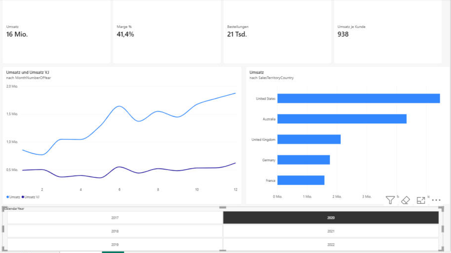
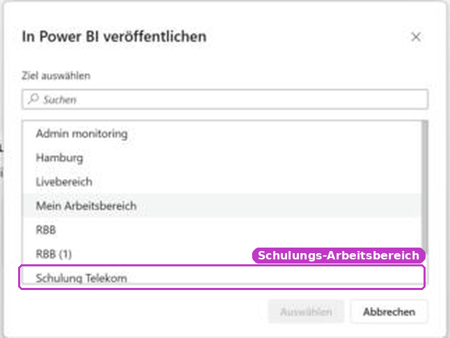
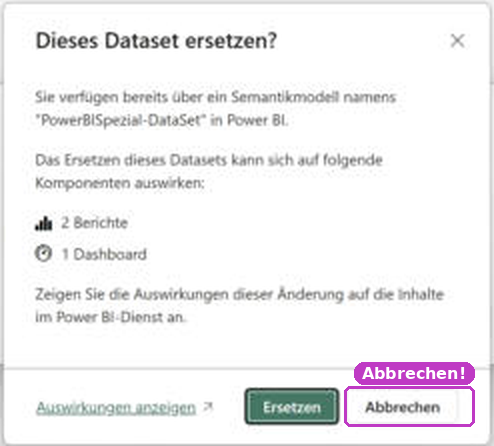
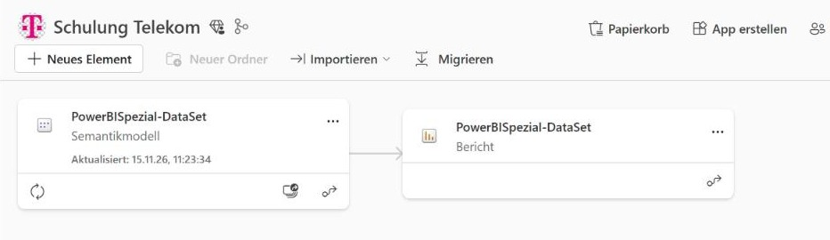
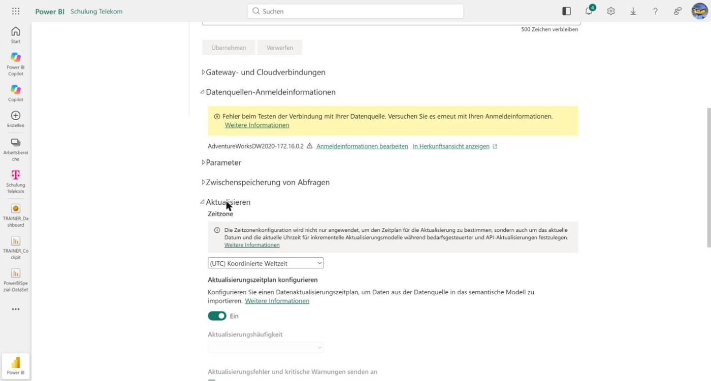

# Lab 1: Projektstart, Ihr Cockpit im Service

| | |
|---|---|
| **Dauer** | 30 Minuten |
| **Ausgangspunkt** | [`daten/AW_Uebungsdaten.pbix`](../daten/AW_Uebungsdaten.pbix) aus diesem Repository |
| **Ergebnis** | Semantikmodell und Bericht `AW_<Projekt>_<Kürzel>` im Schulungs-Arbeitsbereich |

> **Wichtig: Wir sind ca. 10 Personen in einem Arbeitsbereich.** Power BI benennt Modell und Bericht nach dem **Dateinamen**. Wer die Datei unverändert veröffentlicht, überschreibt die Arbeit der anderen. Deshalb **zuerst umbenennen**, dann bauen, dann veröffentlichen. Erscheint beim Veröffentlichen die Frage **„Dieses Dataset ersetzen?“**: **Abbrechen** und den Dateinamen prüfen.

## Ihr Auftrag

Ihr Auftraggeber (siehe [Steckbrief](../README.md#ihr-projekt)) wünscht sich ein **Cockpit**: eine Seite, auf der er in 10 Sekunden sieht, wie es läuft.

Die Datei enthält **alle Daten der AdventureWorksDW2020 als Import**, dazu fertige Kennzahlen im Ordner **Kennzahlen** und drei Rollen für die Zeilensicherheit. Sie brauchen **keine Datenbankverbindung**. Bauen Sie Ihr Cockpit darauf, veröffentlichen Sie es und schauen Sie sich im Service an, was daraus geworden ist.

## Zielbild

So ungefähr soll Ihr Ergebnis aussehen (Beispiel Projekt A, Jahr 2020). Ihr Layout darf anders sein.


*Seite „Cockpit“: Kennzahlen (eine davon eigenes Measure), Verlauf mit Vorjahr, Top 5 Länder, Jahres-Datenschnitt*

## Wo finde ich was?


*Start > Veröffentlichen > den Schulungs-Arbeitsbereich wählen (nicht „Mein Arbeitsbereich“)*


*Diese Frage darf bei Ihnen beim ersten Veröffentlichen nicht kommen. Kommt sie doch: Abbrechen, Datei umbenennen*


*Service > Arbeitsbereich > Ansicht Datenherkunft: Ihr Bericht hängt an Ihrem Semantikmodell*


*Semantikmodell > Einstellungen: Datenquellen-Anmeldeinformationen, Gateway, Zeitzone und Zeitplan (nur ansehen)*

## Abnahme

Visuals bauen Sie wie gewohnt. Dafür bitte **höchstens 10 Minuten**, der Rest gehört dem Service.

- [ ] Datei gespeichert als `AW_<Projekt>_<Kürzel>.pbix`, z. B. `AW_A_ML.pbix`.
- [ ] **Seite „Cockpit“**: Kennzahlen aus dem Ordner **Kennzahlen**, Verlauf mit `Umsatz VJ`, Top 5, Jahres-Datenschnitt.
- [ ] Mindestens **ein eigenes Measure** für Ihr Projekt.
- [ ] **Veröffentlicht** in den Schulungs-Arbeitsbereich. Im Arbeitsbereich gibt es jetzt **ein Semantikmodell und einen Bericht** mit Ihrem Namen.
- [ ] Im Service geprüft:
  - [ ] **Datenherkunft**: Ihr Bericht hängt an Ihrem Modell, nicht an dem einer Kollegin.
  - [ ] Modell > **Einstellungen**: Was steht bei **Datenquellen-Anmeldeinformationen** und **Gateway**? Warum ist der **Zeitplan** aus? (Nur ansehen.)
  - [ ] Ihr Bericht öffnet im Browser, der Jahres-Datenschnitt wirkt.

## Test: Funktioniert es?

Prüfen Sie Ihr Cockpit mit diesen Referenzwerten aus den Übungsdaten. Weicht eine Zahl ab, stimmt meist ein Filter oder eine Beziehung nicht.

| Was Sie einstellen | Erwartetes Ergebnis |
|---|---|
| Kein Projektfilter, Jahr **2020** | `Umsatz` **16.351.550**, `Umsatz VJ` **5.842.485**, `Marge %` **41,4 %**, `Bestellungen` **21.289** |
| Projekt A: Filter Region **Europe**, Jahr **2020** | `Umsatz` **5.464.395**, `Umsatz VJ` **1.969.424**, `Marge %` **41,3 %**, `Bestellungen` **6.203**, `Kunden` **5.265** |
| Projekt A, eigenes Measure `Umsatz je Kunde` (Europe, 2020) | **1.037,87** |
| Projekt A, Top 5 Länder (Europe, 2020) | Nur **drei** Balken: United Kingdom 2.124.007, Germany 1.761.876, France 1.578.512 |
| Kein Projektfilter, Jahres-Datenschnitt leer | `Umsatz` gesamt **29.358.678** (alle Jahre 2018 bis Januar 2021). Projekt A (Europe): **8.930.042** |
| Im **Service** denselben Filter setzen | Exakt dieselben Zahlen wie in Desktop. Der Bericht rechnet auf dem veröffentlichten Modell. |
| Arbeitsbereich > Ihr Modell > **…** > **Datenherkunft anzeigen** | Genau ein Modell `AW_<Projekt>_<Kürzel>` mit genau Ihrem Bericht daneben, kein fremder Bericht |

**Fehlerbilder:** `Umsatz VJ` ist leer: Das Liniendiagramm nutzt kein Feld aus `DimDate`. Alle Länder zeigen denselben Wert: Das Feld stammt aus einer Tabelle ohne Beziehung zur Faktentabelle. Andere Zahlen im Service als in Desktop: Sie schauen auf das Modell einer anderen Person (Datenherkunft prüfen).

<details>
<summary>Hinweise</summary>

- Download: In GitHub die Datei `daten/AW_Uebungsdaten.pbix` öffnen > **Download raw file** (Pfeil-Symbol rechts oben).
- Öffnen Sie die Datei in Desktop und **speichern Sie sie sofort unter** `AW_<Projekt>_<Kürzel>.pbix`.
- **Nicht auf „Aktualisieren“ klicken.** Die Daten sind schon in der Datei. Die Aktualisierung bräuchte Zugriff auf den SQL Server und würde nur Zeit kosten.
- Die Kennzahlen (`Umsatz`, `Umsatz VJ`, `Marge %`, `Bestellungen`, `Kunden` …) liegen im Ordner **Kennzahlen** der Tabellen `FactInternetSales` und `FactResellerSales`. Nutzen Sie sie, statt sie nachzubauen.
- Monatsnamen: `DimDate[EnglishMonthName]` ist schon nach Monatsnummer sortiert.
- Steckbrief B (Produkte): `DimProduct`, `DimProductSubcategory`, `DimProductCategory`. Steckbrief D (Kunden): `DimCustomer`, `DimGeography`.
- Im Service zeigt das Modell eine Warnung zu Anmeldeinformationen oder fehlendem Gateway. Das ist richtig so: Ihre Kopie hat keine Verbindung zur Datenbank. Für die Übungen reichen die importierten Daten.

</details>

<details>
<summary>Lösungsweg (Beispiel Projekt A, Vertrieb Europa)</summary>

1. `AW_Uebungsdaten.pbix` öffnen > **Datei** > **Speichern unter** > `AW_A_ML.pbix`.
2. Seitenfilter: `DimSalesTerritory[SalesTerritoryGroup] = "Europe"`.
3. Eigenes Measure in `FactInternetSales`:

   ```dax
   Umsatz je Kunde =
   DIVIDE ( [Umsatz], [Kunden] )
   ```

4. Karten: `Umsatz`, `Marge %`, `Bestellungen`, `Umsatz je Kunde`.
5. Liniendiagramm: X-Achse `DimDate[EnglishMonthName]`, Werte `Umsatz` und `Umsatz VJ`.
6. Balkendiagramm `Umsatz` nach `DimSalesTerritory[SalesTerritoryCountry]`, Filter Top 5.
7. Datenschnitt `DimDate[CalendarYear]`.
8. **Start** > **Veröffentlichen** > Schulungs-Arbeitsbereich.
9. Im Service: Datenherkunft und Modelleinstellungen ansehen.

</details>

## Wenn Sie früher fertig sind

- Öffnen Sie Ihren Bericht im Service und schauen Sie sich die **Leistungsanalyse** in Desktop an: Welches Visual ist am langsamsten?
- Überlegen Sie: Was wäre anders, wenn alle zehn Berichte **ein** zentrales Modell nutzen würden statt zehn Kopien? (Stichwort Live-Verbindung, Modul 2)
