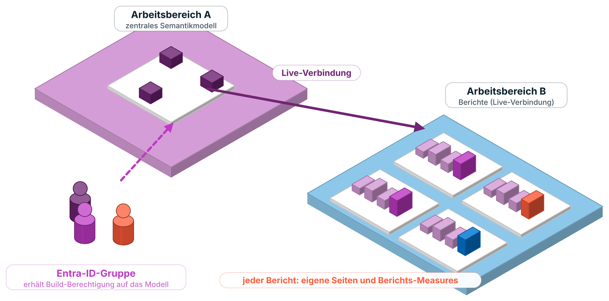
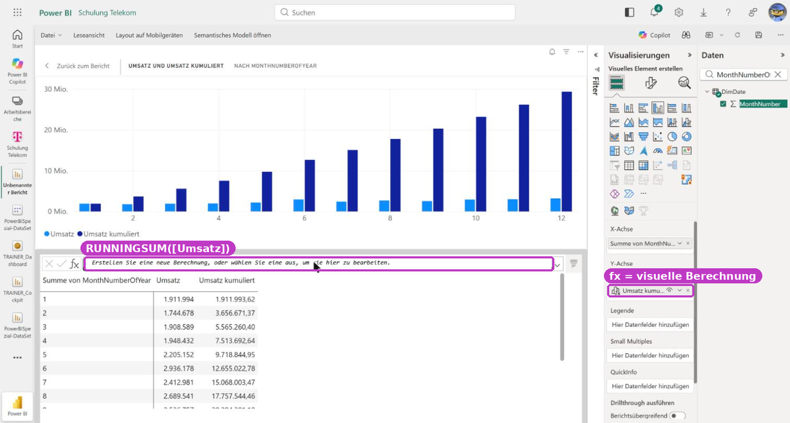
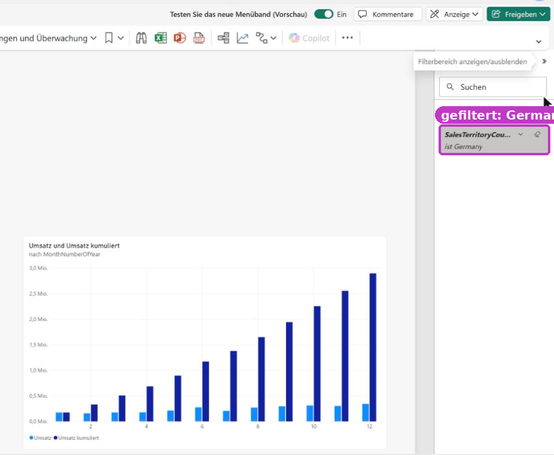
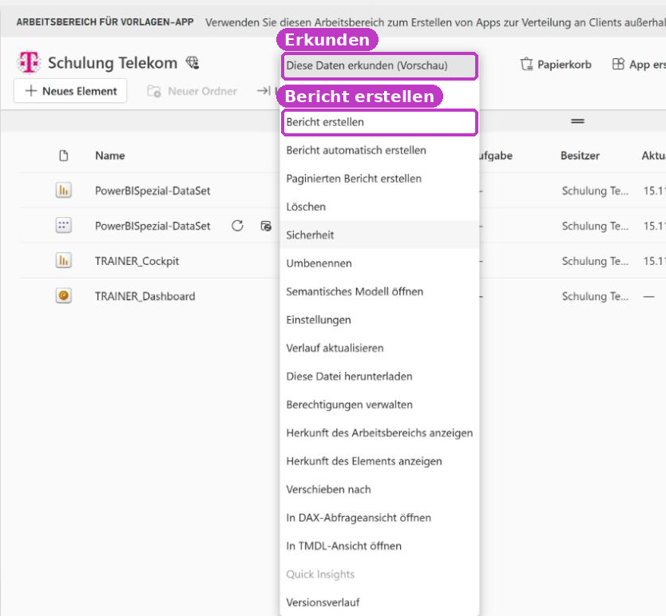
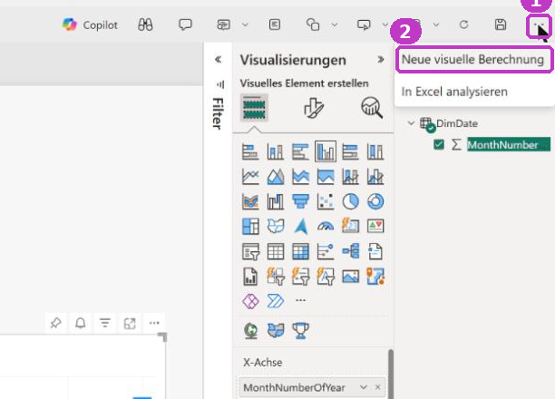
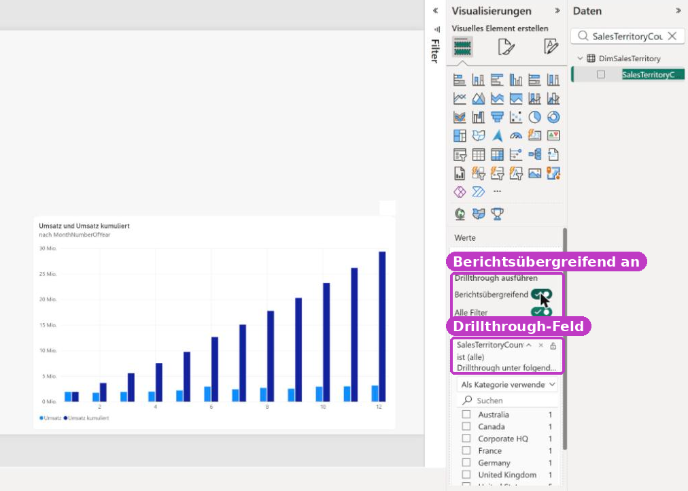
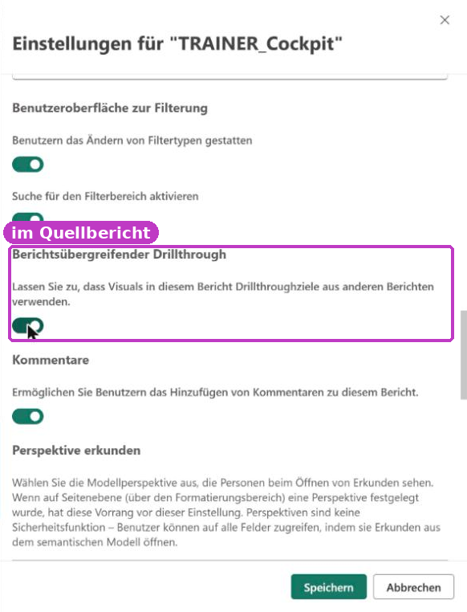
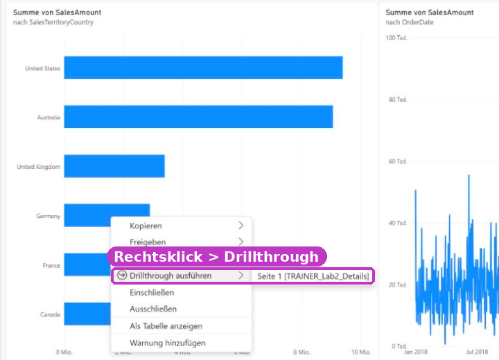

# Lab 2: Im Service weiterbauen

| | |
|---|---|
| **Dauer** | 30 Minuten |
| **Ausgangspunkt** | Ihr Semantikmodell `AW_<Projekt>_<Kürzel>` und Ihr Cockpit aus Lab 1 |
| **Ergebnis** | Bericht `AW_<Projekt>_<Kürzel>_Details`, **komplett im Browser** gebaut, mit visueller Berechnung und berichtsübergreifendem Drillthrough aus dem Cockpit |
| **Werkzeug** | Nur der Browser. Power BI Desktop bleibt heute zu. |

> **Bei uns gilt:** Import-Modelle, **kein DirectQuery**. Ein Modell, viele Berichte: Ihr Detailbericht nutzt **Ihr** Modell aus Lab 1, es entsteht keine Kopie. Achten Sie im Arbeitsbereich darauf, **Ihr** Modell zu wählen, nicht das einer Kollegin.

## Ihr Auftrag

Ihr Auftraggeber möchte aus dem Cockpit heraus **mit einem Klick** in die Details springen, z. B. von einem Land in dessen Monatsverlauf. Bauen Sie dafür einen schlanken Detailbericht, **ohne Desktop**:

1. Bericht im Browser erstellen, auf Ihrem Semantikmodell `AW_<Projekt>_<Kürzel>`.
2. Ein Verlauf mit **visueller Berechnung** (laufende Summe, gleitender Durchschnitt oder Vergleich zur Vorperiode).
3. Die Seite ist **Drillthrough-Ziel** für das wichtigste Merkmal Ihres Projekts, **berichtsübergreifend**.
4. Ihr Cockpit erlaubt den **berichtsübergreifenden Drillthrough**.
5. Für eine Ad-hoc-Frage nutzen Sie **Diese Daten erkunden** und speichern das Ergebnis.

## Zielbild

So ungefähr soll Ihr Ergebnis aussehen. Ihr Layout darf anders sein.

*Bearbeitungsfenster der visuellen Berechnung: oben das Visual, unten die Daten des Visuals mit der neuen Spalte „Umsatz kumuliert“*

*Nach dem Drillthrough aus dem Cockpit: Der Detailbericht ist auf das angeklickte Land gefiltert (rechts im Filterbereich)*

## Wo finde ich was?

*Arbeitsbereich > Semantikmodell > … : **Bericht erstellen** (leerer Bericht im Browser) und **Diese Daten erkunden***

*Visual auswählen > (1) **…** rechts im Menüband > (2) **Neue visuelle Berechnung***

*Zielseite: Feld im Datenbereich rechtsklicken > **Zu Drillthrough hinzufügen**, Schalter **Berichtsübergreifend** an*

*Cockpit öffnen > **Datei** > **Einstellungen** > **Berichtsübergreifender Drillthrough** an > Speichern*

*Im Cockpit: Rechtsklick auf einen Datenpunkt > **Drillthrough ausführen** > Seite im Detailbericht*

## Abnahme

- [ ] `AW_<Projekt>_<Kürzel>_Details` ist im Browser erstellt und gespeichert, auf Ihrem Semantikmodell `AW_<Projekt>_<Kürzel>`. Es entsteht **kein** weiteres Semantikmodell, der neue Bericht hängt an Ihrem Modell aus Lab 1.
- [ ] Ein Visual enthält eine **visuelle Berechnung** (Symbol *fx* im Feldbereich).
- [ ] Die Seite ist Drillthrough-Ziel für Ihr Hauptmerkmal, **Berichtsübergreifend** ist an.
- [ ] Im Cockpit ist **Berichtsübergreifender Drillthrough** in den Einstellungen aktiv.
- [ ] Rechtsklick im Cockpit > **Drillthrough ausführen** öffnet Ihren Detailbericht, korrekt gefiltert.
- [ ] Eine Erkundung `AW_<Projekt>_<Kürzel>_Erkundung` ist gespeichert.

## Test: Funktioniert es?

| Was Sie tun | Erwartetes Ergebnis |
|---|---|
| Detailbericht, Jahr **2020**, Projekt A (Europe): Säulendiagramm `Umsatz` nach Monat mit visueller Berechnung **laufende Summe** | Januar **322.515**, Februar **597.212**, Dezember **5.464.395**. Der Dezemberwert der laufenden Summe ist gleich dem Jahresumsatz. |
| Gleiches Visual ohne Projektfilter, Jahr 2020 | Dezember der laufenden Summe **16.351.550** |
| Visual > Feldbereich | Die visuelle Berechnung trägt das Symbol *fx* und erscheint **nicht** im Datenbereich des Modells |
| Cockpit (Jahr 2020): Rechtsklick auf **Germany** > **Drillthrough ausführen** > Ihr Detailbericht | Detailbericht öffnet sich, Drillthrough-Filter zeigt **Germany**, Umsatz **1.761.876** |
| Gleicher Drillthrough ohne Jahresfilter im Cockpit | Germany alle Jahre: **2.894.312** |
| **Zurück**-Pfeil oben links | Sie landen wieder im Cockpit |
| Arbeitsbereich > Ihr Modell > **Datenherkunft anzeigen** | Am Modell hängen jetzt **zwei** Berichte (Cockpit und Details) und Ihre Erkundung, aber kein zweites Modell |

**Fehlerbilder:** Im Kontextmenü fehlt **Drillthrough ausführen**: Die Einstellung im Cockpit fehlt oder das Cockpit ist nicht neu geladen. Detailbericht öffnet sich ungefiltert: Das Drillthrough-Feld im Ziel ist ein anderes Feld als im Cockpit (gleiche Tabelle und Spalte nötig). Die laufende Summe springt jeden Monat zurück auf den Monatswert: Die Berechnung setzt nicht über die Achse fort (Achse prüfen).

Hinweise

- **Bericht erstellen** öffnet einen leeren Bericht direkt im Bearbeitungsmodus. Speichern über das Disketten-Symbol, Arbeitsbereich „Schulung“ wählen.
- Felder hinzufügen: Kontrollkästchen im Datenbereich. Landet eine Zahl wie `MonthNumberOfYear` auf der Y-Achse, im Feldbereich **⌄** > **Verschieben nach** > **X-Achse**.
- Visuelle Berechnung: Visual auswählen > **…** im Menüband > **Neue visuelle Berechnung**. Über **fx** gibt es Vorlagen. Beispiele:
  - `Umsatz kumuliert = RUNNINGSUM ( [Umsatz] )`
  - `Gleitend 3 = MOVINGAVERAGE ( [Umsatz], 3 )`
  - `Δ Vormonat = [Umsatz] - PREVIOUS ( [Umsatz] )`
- Visuelle Berechnungen leben nur in diesem Visual. Wenn mehrere Berichte die Kennzahl brauchen: Wunsch an den Modellverantwortlichen, damit sie ins zentrale Modell kommt.
- Drillthrough-Feld: Rechtsklick auf das Feld im Datenbereich > **Zu Drillthrough hinzufügen**. Feldnamen müssen in Quelle und Ziel gleich sein. Das ist automatisch so, weil beide Berichte am selben Modell hängen.
- Beide Berichte müssen im **selben Arbeitsbereich** (oder in derselben App) liegen.
- Erkunden: Semantikmodell oder Visual > **…** > **Diese Daten erkunden**. Felder tauschen, filtern, **Speichern**.

Lösungsweg (Beispiel Projekt A)

1. Arbeitsbereich > **Ihr** Semantikmodell `AW_A_ML` > **…** > **Bericht erstellen**.
2. Gruppiertes Säulendiagramm: `Umsatz` und `DimDate[MonthNumberOfYear]` (auf die X-Achse verschieben).
3. **…** > **Neue visuelle Berechnung**: `Umsatz kumuliert = RUNNINGSUM ( [Umsatz] )` > **Zurück zum Bericht**.
4. `DimSalesTerritory[SalesTerritoryCountry]` > Rechtsklick > **Zu Drillthrough hinzufügen**, **Berichtsübergreifend** an.
5. Speichern als `AW_A_ML_Details`.
6. Cockpit öffnen > **Datei** > **Einstellungen** > **Berichtsübergreifender Drillthrough** an > **Speichern**.
7. Cockpit neu laden, Rechtsklick auf ein Land > **Drillthrough ausführen** > Ziel wählen.

## Wenn Sie früher fertig sind

- **Bericht automatisch erstellen** auf Ihrem Modell ausprobieren: Was schlägt der Service vor, was würden Sie übernehmen?
- Öffnen Sie die **Datenherkunftsansicht**. Wie viele Berichte hängen jetzt am zentralen Modell? Was bedeutet das, wenn jemand eine Spalte umbenennt?
- Legen Sie im Browser eine **Berichtsseiten-QuickInfo** an: neue kleine Seite, im Formatbereich unter **Seiteninformationen** „Als QuickInfo verwenden“ einschalten, dann im Säulendiagramm unter **Allgemein** > **QuickInfos** diese Seite wählen. Beim Zeigen auf eine Säule erscheint Ihre Mini-Seite.
