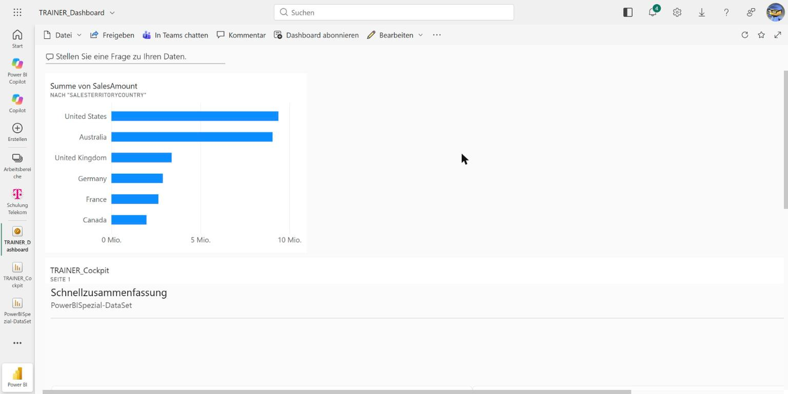
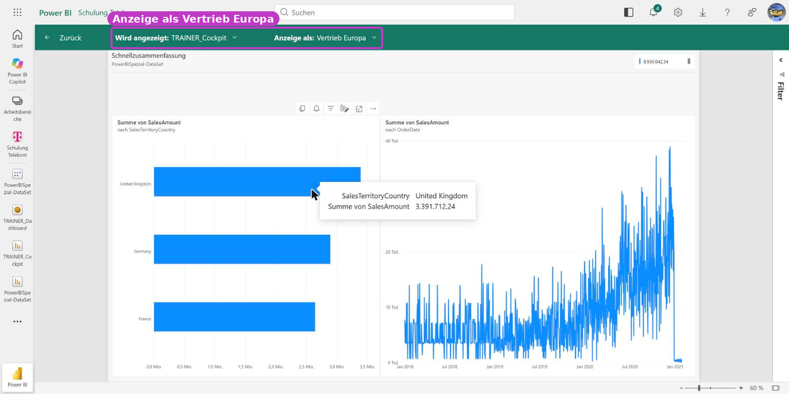
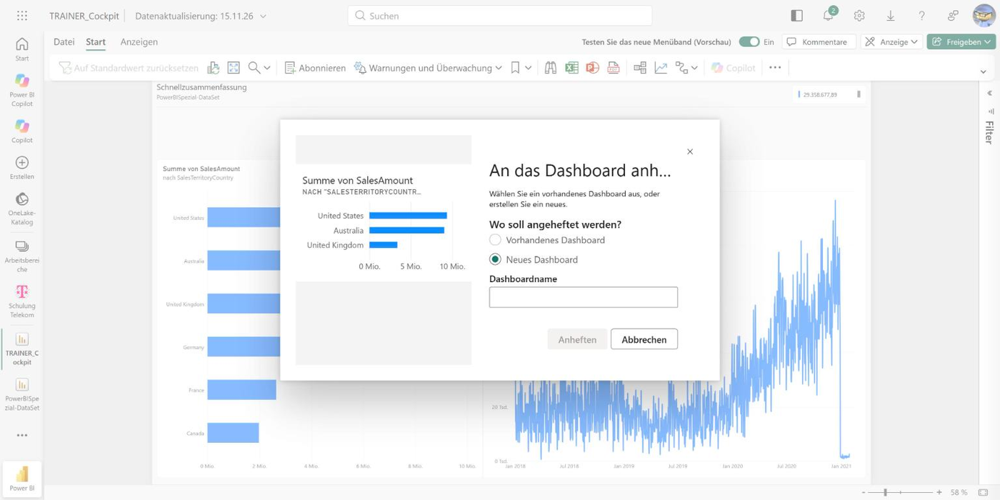
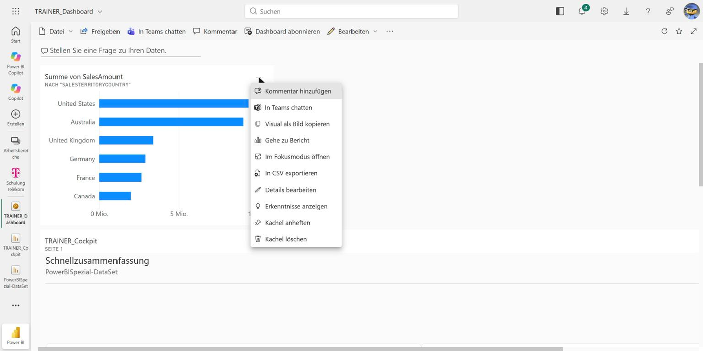
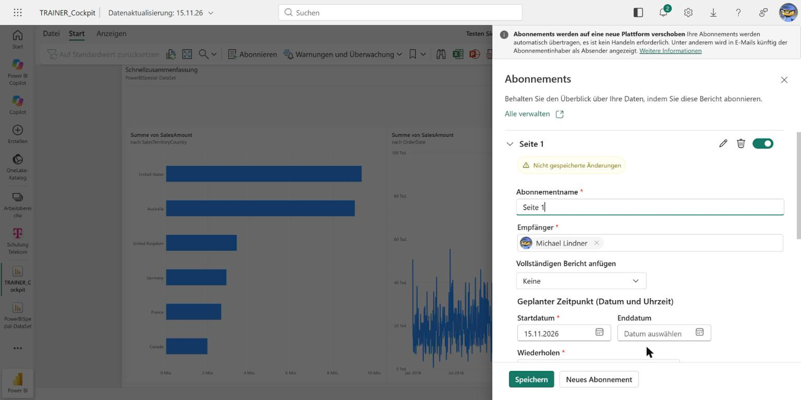
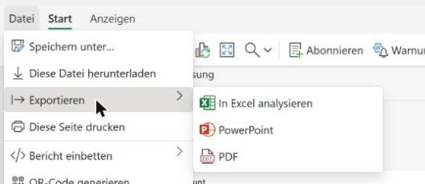
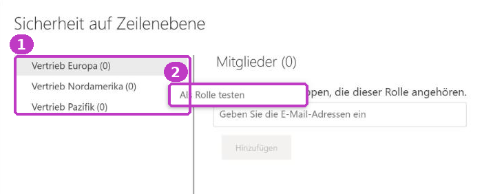

# Lab 3: Verteilen, benachrichtigen, schützen

| | |
|---|---|
| **Dauer** | 30 Minuten |
| **Ausgangspunkt** | Ihr Cockpit und Ihr Detailbericht aus Lab 1 und 2 |
| **Ergebnis** | Dashboard `AW_<Projekt>_<Kürzel>_Dashboard`, Warnung, Abo, live verbundene Excel-Auswertung, geprüfte RLS |

> **Merksatz RLS:** Row-Level Security gilt nur für Nutzer mit der Rolle **Betrachter** oder für Nutzer, die über eine App bzw. Freigabe zugreifen. Wer im Arbeitsbereich Mitwirkender oder höher ist, sieht alles. Deshalb **testen** wir die Rollen heute nur.

## Ihr Auftrag

Ihr Auftraggeber schaut nicht jeden Tag in Berichte. Er will:

1. **Ein Dashboard** als Startseite: das Wichtigste aus Cockpit **und** Detailbericht auf einen Blick, auch auf dem Handy gut lesbar.
2. **Gewarnt werden**, wenn eine Kennzahl einen Schwellwert reißt.
3. **Montags früh eine Mail** mit der Cockpit-Seite.
4. Seine Controller wollen mit **Excel** weiterrechnen, aber immer mit aktuellen Zahlen.
5. Sie sollen **nachweisen**, dass ein Vertriebsleiter mit der Rolle seiner Region wirklich nur seine Region sieht.

## Zielbild

So ungefähr soll Ihr Ergebnis aussehen (Beispiel Projekt A, Jahr 2020). Ihr Layout darf anders sein.

*Dashboard mit Karten und angehefteter Berichtsseite*

*RLS-Test: „Anzeige als: Vertrieb Europa“ zeigt nur United Kingdom, Germany und France*

## Wo finde ich was?

*Visual > Anheften > Neues Dashboard*

*Kachel > … : Warnungen gibt es nur bei Karte, KPI und Messgerät*

*Bericht > Abonnieren > Abonnement erstellen*

*Exportieren > In Excel analysieren*

*Semantikmodell > … > Sicherheit: (1) Rollen, (2) … > Als Rolle testen*

## Abnahme

- [ ] Dashboard `AW_<Projekt>_<Kürzel>_Dashboard` mit **mindestens 5 Kacheln** aus **beiden** Berichten (Cockpit und Details), darunter eine **Karte** und eine **ganze angeheftete Berichtsseite** (Live-Seite).
- [ ] **Mobile Ansicht** des Dashboards ist eingerichtet (Kacheln sortiert und in der Größe angepasst).
- [ ] Auf einer Karten-Kachel ist eine **Datenwarnung** gesetzt.
- [ ] **Abonnement** für die Cockpit-Seite: wöchentlich montags 07:00, an Sie selbst, mit Ihrem Projektfilter.
- [ ] **In Excel analysieren**: PivotTable mit `Umsatz` und `Umsatz VJ` nach Jahr und Ihrem Hauptmerkmal. **Daten** > **Alle aktualisieren** funktioniert.
- [ ] **RLS-Test:** Mit **Als Rolle testen** auf Ihrem Modell `AW_<Projekt>_<Kürzel>` haben Sie Ihr Cockpit als Rolle `Vertrieb Europa` angezeigt und notiert, welche Zahl sich wie verändert.
- [ ] Diskussionsfrage beantwortet: Warum sieht **Sie** im Arbeitsbereich trotzdem alle Regionen, und wie kommt ein Vertriebsleiter an den Bericht, damit RLS greift?

## Test: Funktioniert es?

| Was Sie tun | Erwartetes Ergebnis |
|---|---|
| Dashboard öffnen, auf die Karte `Umsatz` klicken | Der Quellbericht öffnet sich auf der Seite, von der die Kachel stammt |
| Dashboard > **Bearbeiten** > **Mobiles Layout** bzw. Dashboard auf dem Handy öffnen | Karte oben, Live-Seite darunter, nichts abgeschnitten |
| Kachel > **…** > **Warnungen verwalten** | Ihre Regel ist aufgeführt und **aktiv**. Hinweis: Warnungen werden nur nach einer Datenaktualisierung geprüft. Ihr Übungsmodell wird nicht aktualisiert, deshalb kommt heute keine Mail. |
| Cockpit > **Abonnieren** > Ihr Abo > **Jetzt senden** | Innerhalb weniger Minuten kommt eine Mail mit einem Bild der Cockpit-Seite, **mit Ihrem Projektfilter** (Projekt A: Umsatz 2020 **5.464.395**) |
| Excel: PivotTable `Umsatz` nach `CalendarYear`, Filter Region Europe | 2018 **1.486.036**, 2019 **1.969.424**, 2020 **5.464.395**, 2021 **10.187** (nur Januar), Gesamt **8.930.042**. Dieselben Zahlen wie im Cockpit. |
| Excel: **Daten** > **Alle aktualisieren** | Keine Fehlermeldung, die Verbindung geht live auf Ihr Modell |
| Modell > **Sicherheit** > `Vertrieb Europa` > **Als Rolle testen** > Cockpit, **ohne** Projektfilter | Umsatz alle Jahre **8.930.042** statt 29.358.678. Im Länder-Visual nur **United Kingdom, Germany, France** |
| Gleicher Test mit `Vertrieb Nordamerika` | Umsatz alle Jahre **11.367.635**, nur United States und Canada |
| **Jetzt anzeigen als** schließen | Wieder alle Regionen sichtbar |

**Fehlerbilder:** Bei **Als Rolle testen** ändern sich die Zahlen nicht: Sie haben den Bericht eines anderen Modells gewählt oder die Rolle filtert eine Tabelle ohne Beziehung zu den Visuals. **Warnungen verwalten** fehlt: Die Kachel ist kein Karten-, KPI- oder Messgerät-Visual. Die Abo-Mail zeigt alle Regionen: Das Abo wurde ohne gesetzten Filter angelegt.

Hinweise

- Anheften: Bericht im Service öffnen > Visual > **Anheften** (Pin). Ganze Seite: **…** in der Menüleiste > **Live-Seite anheften** (Pin a live page).
- Neues Dashboard entsteht direkt im Anheften-Dialog.
- Dashboard und Copilot: Laut Microsoft lassen sich auch Copilot-Antworten an ein Dashboard anheften. So wird das Dashboard zur Sammelstelle für das Management. Als Quelle für Copilot-Fragen dient es aber nicht, Copilot arbeitet mit Berichten und Semantikmodellen.
- Mobile Ansicht: Dashboard > **Bearbeiten** > **Mobiles Layout**.
- Warnungen gibt es auf Dashboard-Kacheln vom Typ **Karte**, **KPI** und **Messgerät**: Kachel > **…** > **Warnungen verwalten**.
- Die Funktion **Warnung festlegen** direkt im Bericht erzeugt ein Fabric-Activator-Element. Das gehört bei uns **nicht** zur Zielarchitektur. Bitte die Dashboard-Warnung nutzen.
- Abo mit Filter: erst im Bericht den Filter setzen, dann **Abonnieren**. Das Abo übernimmt die aktuelle Ansicht.
- Excel: bei Ihrem Semantikmodell `AW_<Projekt>_<Kürzel>` **…** > **In Excel analysieren**. Die Datei liegt danach in Ihrem OneDrive.
- RLS-Test: Arbeitsbereich > Ihr Modell `AW_<Projekt>_<Kürzel>` > **…** > **Sicherheit** > Rolle > **…** > **Als Rolle testen**. Oben **Jetzt anzeigen als** > anderen Bericht wählen, z. B. Ihr Cockpit.

Lösungsweg

1. Cockpit öffnen: Karte `Umsatz` anheften > **Neues Dashboard** `AW_A_ML_Dashboard`.
2. Weitere Kacheln aus Cockpit und Details anheften, eine komplette Seite als Live-Seite.
3. Dashboard > **Bearbeiten** > **Mobiles Layout**: Karte oben, Live-Seite unten.
4. Kachel `Umsatz` > **…** > **Warnungen verwalten** > Regel „über“ Schwellwert, max. einmal täglich.
5. Cockpit: Projektfilter setzen > **Abonnieren** > **Abonnement erstellen** > montags 07:00.
6. Ihr Modell `AW_A_ML` > **In Excel analysieren** > PivotTable.
7. Ihr Modell `AW_A_ML` > **Sicherheit** > `Vertrieb Europa` > **Als Rolle testen** > Cockpit auswählen.

**Diskussionsfrage:** RLS gilt nur für **Betrachter** und für Nutzer, die über eine **App** oder eine Freigabe zugreifen. Sie sind im Arbeitsbereich Mitwirkender und sehen deshalb alles. Ein Vertriebsleiter bekommt den Bericht über die **App**, und die Admins ordnen seine Entra-ID-Gruppe der passenden Rolle zu (Semantikmodell > Sicherheit). Mit **Als Rolle testen** prüfen Sie das vorher.

## Wenn Sie früher fertig sind

- Öffnen Sie Ihr Dashboard in der **Power BI Mobile App** und prüfen Sie, wie die Warnung ankommt.
- Fügen Sie Ihren Bericht als **Registerkarte in einem Teams-Kanal** ein. Wer sieht dort was?

**Weiter mit [Lab 3 Teil B: Ihre Organisations-App](../Lab-07-App/README.md).**
