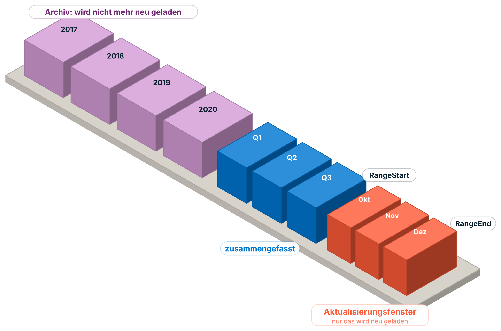
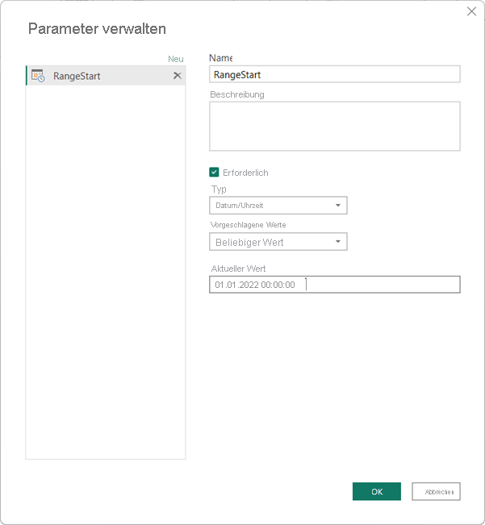
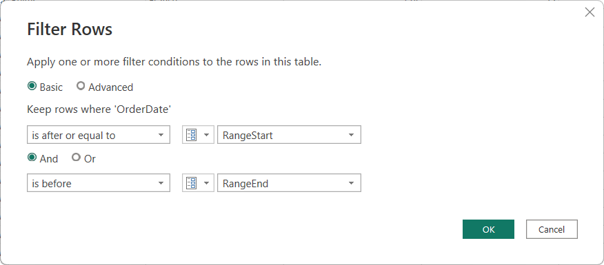

# Lab 4: Ihr Modell für große Datenmengen

| | |
|---|---|
| **Dauer** | 30 Minuten |
| **Ausgangspunkt** | Ihre Datei `AW_<Projekt>_<Kürzel>.pbix` aus Lab 1 |
| **Ergebnis** | Ihr Semantikmodell `AW_<Projekt>_<Kürzel>`, im Service eingerichtet, höhergestuft, mit What-If-Parameter neu veröffentlicht |

> **So läuft dieses Lab:** Die inkrementelle Aktualisierung braucht eine Verbindung zum SQL Server. Die hat im Kurs nur der Trainer, deshalb zeigt er diesen Teil vorab als Demo (Teil A). Sie arbeiten mit Ihrem Modell aus Lab 1 im Service (Teil B) und in Desktop mit What-If und Prognose (Teil C).
>
> **Ersetzen ist hier richtig:** Sie veröffentlichen **Ihre eigene** Datei erneut. Die Frage „Dieses Dataset ersetzen?“ muss Ihren Namen `AW_<Projekt>_<Kürzel>` zeigen. Steht dort ein anderer Name: Abbrechen.

## Ihr Auftrag

Die Power-Query- und Modellierungsarbeit in Desktop kennen Sie. Der Schwerpunkt liegt auf dem, was **danach im Service** passiert: Aktualisierung, Gateway, Höherstufen, Rollen und Speicherbedarf.

Ihr Projekt wächst. Ihr Auftraggeber möchte wissen, wie Ihr Modell im Service betrieben wird, wer es wiederverwenden darf und wie groß es ist. Außerdem soll er im Bericht durchspielen können, was eine Preisänderung bewirkt.

## Teil A: Demo inkrementelle Aktualisierung (Trainer)

Der Trainer zeigt in Desktop und SSMS, wie die große Faktentabelle nur noch in einem Zeitfenster geladen wird. Die Bilder helfen Ihnen beim Nachvollziehen und später im eigenen Projekt.

*Power Query > Parameter verwalten: RangeStart/RangeEnd als Datum/Uhrzeit (Bild: Microsoft Learn)*

*Spalte OrderDate > Datumsfilter > Benutzerdefiniert: ist nach oder gleich RangeStart UND ist vor RangeEnd (Bild: Microsoft Learn)*

*Tabellenansicht > Rechtsklick auf die Faktentabelle > Inkrementelle Aktualisierung (Bild: Microsoft Learn)*

*Richtlinie für inkrementelle Aktualisierung (Bild: Microsoft Learn)*

**Darauf achten Sie in der Demo:**

- Die Parameter heißen exakt `RangeStart` und `RangeEnd` und sind vom Typ **Datum/Uhrzeit**. Sonst bleibt der Dialog grau.
- Filter: `OrderDate` **>=** `RangeStart` **und** **<** `RangeEnd`. Nie beide Grenzen mit Gleichheitszeichen, sonst doppelte Umsätze an Monatsgrenzen.
- **Native Abfrage anzeigen** zeigt eine WHERE-Klausel: Das ist Query Folding. Ausgegraut heißt: Folding gebrochen.
- Desktop lädt nur das kleine Parameterfenster, der Service lädt später die gesamte Historie und legt Partitionen nach Jahr, Quartal und Monat an (in SSMS sichtbar).

> **Nicht selbst nachbauen:** Ihre Datei hat keine Verbindung zur Datenbank. Jeder geänderte Abfrageschritt löst in Desktop eine Aktualisierung aus, die fehlschlägt.

## Wo finde ich was?

*Nach dem Veröffentlichen: Modelleinstellungen > Serververbindung (XMLA-Adresse) für SSMS*

## Abnahme

**Teil B: Service**

- [ ] **Einstellungen** > **Datenquellen-Anmeldeinformationen**, **Gateway- und Cloudverbindungen** und **Aktualisieren** angesehen: Warum lässt sich bei Ihrem Modell kein Zeitplan einschalten, und was bräuchte es dafür?
- [ ] **Aktualisierungsverlauf** angesehen: Was steht dort?
- [ ] Modell **höhergestuft** und mit einer **Beschreibung** versehen.
- [ ] **Sicherheit**: Rolle `Vertrieb Europa` mit **Als Rolle testen** auf Ihrem Bericht geprüft.
- [ ] **Semantisches Modell öffnen** > **Speicheranalyse**: größte Tabelle und größte Spalte notiert.
- [ ] XMLA-Adresse aus den Einstellungen kopiert.

**Teil C: What-If und Prognose (Desktop)**

- [ ] Siehe [Teil C: What-If-Simulation und Prognose](../Lab-06-WhatIf/README.md).
- [ ] Mindestens 3 Measures haben eine **Beschreibung** (Modellansicht > Measure > Eigenschaften). Die Beschreibung hilft später Copilot.
- [ ] Erneut veröffentlicht als `AW_<Projekt>_<Kürzel>` (eigenes Modell ersetzen) und die Schieberegler im Service ausprobiert.
- [ ] Vorlage `AW_<Projekt>_Vorlage.pbit` exportiert (**Datei** > **Exportieren** > **Power BI-Vorlage**).

## Test: Funktioniert es?

| Was Sie tun | Erwartetes Ergebnis |
|---|---|
| Modell > **Einstellungen** > **Aktualisieren** | Zeitplan ist aus und lässt sich nicht einschalten. Hinweis auf fehlende Anmeldeinformationen bzw. fehlendes Gateway: Ihre Kopie hat keinen Weg zur Datenbank. |
| Arbeitsbereichsliste | Ihr Modell zeigt das Kennzeichen **Höhergestuft** |
| Bericht mit **Als Rolle testen** > `Vertrieb Europa` | Nur United Kingdom, Germany, France |
| **Semantisches Modell öffnen** > **Speicheranalyse** | Die größte Tabelle ist eine Faktentabelle (`FactInternetSales` bzw. `FactResellerSales`), nicht eine Dimension |
| Modellansicht > Measure mit Beschreibung, im Bericht mit der Maus über das Feld fahren | Die Beschreibung erscheint als Quickinfo |
| `AW_<Projekt>_Vorlage.pbit` im Explorer | Die Datei ist viel kleiner als Ihre .pbix: Sie enthält Modell, Kennzahlen und Berichte, aber keine Daten |

Hinweise

- Ohne Gateway kann der Service eine Datenbank im Firmennetz nicht erreichen. In der Praxis richtet die IT eine Gateway-Verbindung ein, Sie ordnen sie unter **Gateway- und Cloudverbindungen** zu, dann lässt sich der Zeitplan einschalten.
- Höherstufen: **Einstellungen** > **Bestätigung**. Zertifizieren darf nur, wen der Administrator freigegeben hat.
- **Als Rolle testen**: im Arbeitsbereich beim Modell **…** > **Sicherheit** > Rolle **…** > **Als Rolle testen**.
- **Nicht** auf **Jetzt aktualisieren** klicken: Die Aktualisierung schlägt ohne Datenbankzugriff fehl und kostet nur Zeit.
- Die .pbit nicht per Doppelklick öffnen: Power BI versucht dann, die Daten aus der Datenbank zu laden.

## Wenn Sie früher fertig sind

- Welche Spalte bräuchte AdventureWorks für **Datenänderungen erkennen**, und was würde das in der Praxis sparen?
- Verbinden Sie sich mit SQL Server Management Studio über den XMLA-Endpunkt `powerbi://api.powerbi.com/v1.0/myorg/<Arbeitsbereich>` und sehen Sie sich die Partitionen Ihres Modells an. Sie sehen eine Partition je Tabelle, beim Trainer-Modell mit inkrementeller Aktualisierung viele. **Nicht** über XMLA ändern: Danach lässt sich das Modell nicht mehr als .pbix herunterladen.
