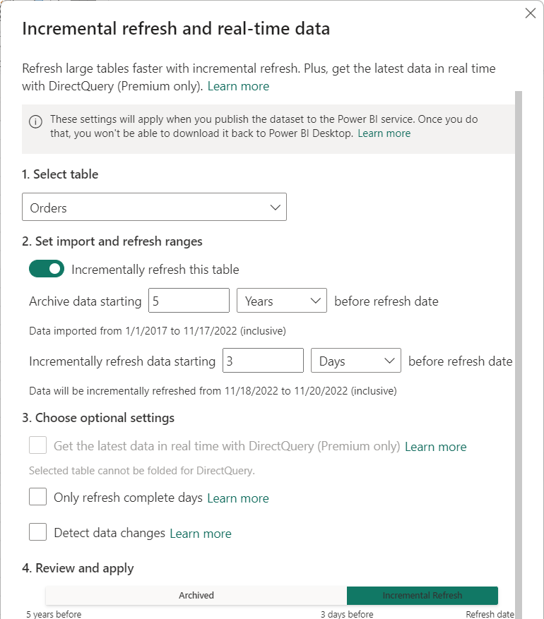
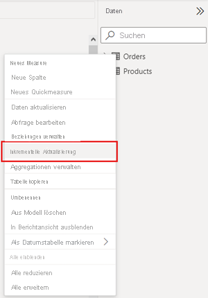
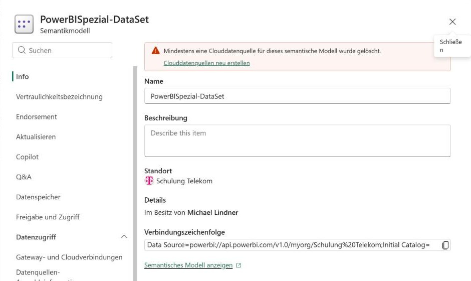

# Lab 4: Ihr Modell für große Datenmengen

| | |
|---|---|
| **Dauer** | 30 Minuten |
| **Ausgangspunkt** | Ihre Datei `AW_<Projekt>_<Kürzel>.pbix` aus Lab 1 |
| **Ergebnis** | Ihr Semantikmodell `AW_<Projekt>_<Kürzel>`, verschlankt, mit Richtlinie für inkrementelle Aktualisierung, neu veröffentlicht und im Service eingerichtet |

> **Zwei Wege, je nach Netzwerk:** Mit Zugriff auf den SQL Server bauen Sie die inkrementelle Aktualisierung selbst (Teil A + B). Ohne Zugriff machen Sie Teil B im Service und [Teil C: What-If](../Lab-06-WhatIf/README.md) in Desktop. Beide Wege sind vollwertig.
>
> **Ersetzen ist hier richtig:** Sie veröffentlichen **Ihre eigene** Datei erneut. Die Frage „Dieses Dataset ersetzen?“ muss Ihren Namen `AW_<Projekt>_<Kürzel>` zeigen. Steht dort ein anderer Name: Abbrechen.


## Ihr Auftrag

Die Power-Query- und Modellierungsarbeit in Desktop kennen Sie. Der Schwerpunkt liegt auf dem, was **danach im Service** passiert: Gateway, Zeitplan, inkrementelle Aktualisierung mit Partitionen, Rollen und Höherstufen.

Ihr Projekt wächst. Ihr Auftraggeber möchte ein **eigenes, schlankes Modell** nur für sein Thema, das jeden Tag schnell aktualisiert wird und das andere Teams als Vorlage nutzen können.

Bauen Sie ein neues Import-Modell aus der Datenbank, nur mit den Tabellen und Spalten, die Ihr Projekt braucht. Die große Faktentabelle soll **inkrementell** aktualisiert werden. Die Region soll per **RLS** geschützt sein. Andere sollen Ihr Modell als **.pbit-Vorlage** nachbauen können, auch gegen eine andere Datenbank.

## Zielbild

So ungefähr soll Ihr Ergebnis aussehen (Beispiel Projekt A, Jahr 2020). Ihr Layout darf anders sein.


*Richtlinie für inkrementelle Aktualisierung (Bild: Microsoft Learn)*

## Wo finde ich was?


*Power Query > Parameter verwalten: RangeStart/RangeEnd als Datum/Uhrzeit (Bild: Microsoft Learn)*


*Spalte OrderDate > Datumsfilter > Benutzerdefiniert: ist nach oder gleich RangeStart UND ist vor RangeEnd (Bild: Microsoft Learn)*


*Tabellenansicht > Rechtsklick auf die Faktentabelle > Inkrementelle Aktualisierung (Bild: Microsoft Learn)*


*Nach dem Veröffentlichen: Modelleinstellungen > Serververbindung (XMLA-Adresse) für SSMS*

## Abnahme

**Teil A: Desktop (nur mit Zugriff auf den SQL Server)**

- [ ] Unnötige Tabellen entfernt (z. B. `FactFinance`, `FactCurrencyRate`, `DimAccount`, `DimScenario`), wenn Ihr Steckbrief sie nicht braucht.
- [ ] Server und Datenbank kommen aus den Parametern `Server` und `Datenbank`.
- [ ] Ihre Faktentabelle ist mit `RangeStart`/`RangeEnd` gefiltert, **Query Folding** ist nachgewiesen (Native Abfrage mit WHERE-Klausel).
- [ ] Richtlinie für inkrementelle Aktualisierung: gesamte Historie archivieren, letzte 3 Monate aktualisieren.
- [ ] Mindestens 3 Measures haben eine **Beschreibung** (die Beschreibung hilft später Copilot).
- [ ] Erneut veröffentlicht als `AW_<Projekt>_<Kürzel>` (eigenes Modell ersetzen).

**Teil B: Service (alle)**

- [ ] **Einstellungen** > **Aktualisieren**: Zeitzone Berlin, Zeitplan täglich 06:00, Fehler-Mail an Sie. Mit Gateway-Zugriff: Verbindung zuordnen und **Jetzt aktualisieren**, sonst nur einrichten.
- [ ] **Aktualisierungsverlauf** angesehen: Was steht dort?
- [ ] Modell **höhergestuft** und mit einer **Beschreibung** versehen.
- [ ] **Sicherheit**: Rolle `Vertrieb Europa` mit **Als Rolle testen** auf Ihrem Bericht geprüft.
- [ ] **Semantisches Modell öffnen** > **Speicheranalyse**: größte Tabelle und größte Spalte notiert.
- [ ] XMLA-Adresse aus den Einstellungen kopiert.
- [ ] Vorlage `AW_<Projekt>_Vorlage.pbit` exportiert (**Datei** > **Exportieren** > **Power BI-Vorlage**).

**Teil C: What-If (ohne Datenbankzugriff, oder wer früher fertig ist)**

- [ ] Siehe [Teil C: What-If-Simulation und Prognose](../Lab-06-WhatIf/README.md). Danach erneut veröffentlichen (eigenes Modell ersetzen) und die Schieberegler im Service ausprobieren.

## Test: Funktioniert es?

Referenzwerte am Beispiel Projekt C (Händlergeschäft, `FactResellerSales`). Wer `FactInternetSales` nutzt, vergleicht mit den Zahlen aus Lab 1.

**Teil A in Desktop (mit Datenbankzugriff)**

| Was Sie tun | Erwartetes Ergebnis |
|---|---|
| Power Query: letzter Schritt von `FactResellerSales` > Rechtsklick > **Native Abfrage anzeigen** | SQL-Text mit `where [_].[OrderDate] >= ... and [_].[OrderDate] < ...`. Ist **Native Abfrage anzeigen** grau, ist das Query Folding gebrochen. |
| Nach **Schließen & übernehmen**, Tabellenansicht `FactResellerSales` (RangeStart 01.01.2020, RangeEnd 01.02.2020) | Unten links **1.382 Zeilen**, `Händlerumsatz` **1.664.187**. Desktop lädt nur das Parameterfenster. |
| Rechtsklick auf `FactResellerSales` > **Inkrementelle Aktualisierung** | Dialog ist bedienbar und zeigt Archivierungs- und Aktualisierungszeitraum. Grau: Parameter sind nicht vom Typ Datum/Uhrzeit oder heißen nicht exakt `RangeStart`/`RangeEnd`. |
| **Anzeigen als** > `Vertrieb Europa` | Nur United Kingdom, Germany, France |

**Teil A im Service (nach Veröffentlichen und Jetzt aktualisieren)**

| Was Sie tun | Erwartetes Ergebnis |
|---|---|
| Bericht auf dem neuen Modell: Karte `Händlerumsatz`, kein Filter | **77.548.570**, also alle Zeilen von Juli 2017 bis Mai 2020, nicht nur Januar 2020 |
| `Händlerumsatz` nach Jahr | 2017 **8.069.756**, 2018 **24.328.786**, 2019 **32.500.006**, 2020 **12.650.023** |
| `Aktive Händler`, kein Filter | **632** |
| Gleiche Werte im zentralen Modell (Ihr Modell aus Lab 1) | Identisch. Ihr schlankes Modell rechnet dasselbe wie das große. |
| SSMS über die XMLA-Adresse > Ihr Modell > `FactResellerSales` > **Partitionen** | Mehrere Partitionen nach Jahr, Quartal und Monat. Die Monatspartitionen der letzten drei Monate sind **leer**, weil die Daten im Mai 2020 enden. |

**Teil B im Service (alle)**

| Was Sie tun | Erwartetes Ergebnis |
|---|---|
| Modell > **Einstellungen** > **Aktualisieren** | Zeitzone **(UTC+01:00) Amsterdam, Berlin …**, nächste Aktualisierung morgen **06:00** |
| Arbeitsbereichsliste | Ihr Modell zeigt das Kennzeichen **Höhergestuft** |
| **Semantisches Modell öffnen** > **Speicheranalyse** | Die größte Tabelle ist eine Faktentabelle (`FactInternetSales` bzw. `FactResellerSales`), nicht eine Dimension |
| `AW_<Projekt>_Vorlage.pbit` per Doppelklick öffnen | Power BI fragt nach `Server` und `Datenbank`, dann nach `RangeStart`/`RangeEnd`, und lädt danach die Daten |

**Fehlerbilder:** Im Service steht nach der Aktualisierung nur der Januar 2020: Die Richtlinie wurde nicht gespeichert oder das Modell nicht neu veröffentlicht. Doppelte Umsätze an Monatsgrenzen: Der Filter nutzt auf beiden Seiten ein Gleichheitszeichen.

<details>
<summary>Hinweise</summary>

- Parameter: **Daten transformieren** > **Parameter verwalten**. `Server` und `Datenbank` als Text, `RangeStart` und `RangeEnd` als **Datum/Uhrzeit**, genau so geschrieben.
- Quelle umstellen: `Sql.Database(Server, Datenbank)`. Tipp: eine gemeinsame Abfrage `Quelle`, alle Tabellen verweisen darauf.
- Filter: `OrderDate` **>=** `RangeStart` **und** **<** `RangeEnd`. Nie beide Grenzen mit Gleichheitszeichen.
- Query Folding prüfen: Rechtsklick auf den letzten Schritt > **Native Abfrage anzeigen**. Ausgegraut heißt: Folding gebrochen.
- Setzen Sie `RangeStart`/`RangeEnd` in Desktop auf einen **kleinen** Zeitraum (z. B. ein Monat). Desktop lädt dann wenig. Der Service lädt später alles.
- Beziehung Datum: `FactInternetSales[OrderDate]` > `DimDate[FullDateAlternateKey]`.
- Region für RLS: In AdventureWorks führen zwei Wege zu `DimSalesTerritory` (direkt und über Kunde > Geografie). Nur einer darf aktiv sein. Für RLS nehmen Sie den **direkten** Weg aus der Faktentabelle.
- Inkrementelle Aktualisierung: Rechtsklick auf die Faktentabelle > **Inkrementelle Aktualisierung**.
- AdventureWorks enthält nur historische Daten. Im Fenster „letzte 3 Monate“ liegen deshalb keine Zeilen. Das ist für die Übung in Ordnung.
- Nach dem Veröffentlichen: **Einstellungen** > **Gateway- und Cloudverbindungen** > Verbindung zuordnen > **Jetzt aktualisieren**.
- **Ohne Datenbankzugriff:** Teil A nicht anfangen. Ein geänderter Abfrageschritt löst in Desktop eine Aktualisierung aus, die ohne Datenbank fehlschlägt. Machen Sie Teil B auf Ihrem Modell aus Lab 1.

</details>

<details>
<summary>Lösungsweg (Beispiel Projekt C, Händlergeschäft)</summary>

1. Leere Datei > Parameter `Server`, `Datenbank`, `RangeStart` (01.01.2020), `RangeEnd` (01.02.2020).
2. Abfrage `Quelle = Sql.Database(Server, Datenbank)`, davon `FactResellerSales`, `DimReseller`, `DimEmployee`, `DimProduct`, `DimProductSubcategory`, `DimProductCategory`, `DimSalesTerritory`, `DimDate` als Verweise.
3. Unnötige Spalten entfernen (alle Spanish-/French-Spalten, Beschreibungen, Telefonnummern).
4. `FactResellerSales`: Filter `OrderDate >= RangeStart and OrderDate < RangeEnd`. **Native Abfrage anzeigen** zeigt `where [_].[OrderDate] >= ... and [_].[OrderDate] < ...`.
5. Laden. Beziehungen setzen, `DimDate` als Datumstabelle markieren, Schlüssel ausblenden.
6. Measures:

   ```dax
   Händlerumsatz = SUM ( FactResellerSales[SalesAmount] )
   Händlermarge % = DIVIDE ( [Händlerumsatz] - SUM ( FactResellerSales[TotalProductCost] ), [Händlerumsatz] )
   Aktive Händler = DISTINCTCOUNT ( FactResellerSales[ResellerKey] )
   ```

   In der Modellansicht jeweils eine **Beschreibung** eintragen.
7. Rolle `Vertrieb Europa`: `DimSalesTerritory[SalesTerritoryGroup] = "Europe"`. Mit **Anzeigen als** testen.
8. Inkrementelle Aktualisierung: archivieren 10 Jahre, aktualisieren 3 Monate.
9. Veröffentlichen > Gateway zuordnen > **Jetzt aktualisieren**.
10. **Datei** > **Exportieren** > **Power BI-Vorlage**.

</details>

## Wenn Sie früher fertig sind

- Aktivieren Sie **Datenänderungen erkennen**. Welche Spalte bräuchte AdventureWorks dafür, und was würde das in der Praxis sparen?
- Verbinden Sie sich mit SQL Server Management Studio über den XMLA-Endpunkt `powerbi://api.powerbi.com/v1.0/myorg/<Arbeitsbereich>` und sehen Sie sich die Partitionen Ihres Modells an. **Nicht** über XMLA ändern: Danach lässt sich das Modell nicht mehr als .pbix herunterladen.
