# Lab 5: Cloud-Stationen

| | |
|---|---|
| **Dauer** | 30 Minuten |
| **Ziel** | Die Neuerungen im Power BI Service selbst ausprobieren, nach eigenem Interesse |
| **Grundlage** | Ihr Cockpit aus Lab 1 (Bericht `AW_<Projekt>_<Kürzel>`) und Ihr Modell aus Lab 4 |
| **Auftrag** | Wählen Sie **mindestens 8 der 14 Stationen**. Haken Sie erledigte Stationen ab. |

> **Spielregeln:** Sie ändern keine Rollen oder Berechtigungen im Arbeitsbereich. Teilen Sie nur mit Kolleginnen und Kollegen aus dem Kurs. Arbeiten Sie nur an Ihren **eigenen** Elementen (`AW_<Projekt>_<Kürzel>…`), nie an denen der anderen.

## Übersicht

| Nr. | Station | Bereich | Zeit |
|---|---|---|---|
| 1 | Link teilen und QR-Code | Teilen | 2 Min. |
| 2 | Kommentar mit @-Erwähnung | Teilen | 2 Min. |
| 3 | Persönliches Lesezeichen als Standardansicht | Nutzen | 2 Min. |
| 4 | „Diese Daten erkunden“ | Nutzen | 3 Min. |
| 5 | Als Tabelle anzeigen und Einblicke | Nutzen | 2 Min. |
| 6 | Seite live nach PowerPoint | Nutzen | 3 Min. |
| 7 | Bericht in Teams | Teilen | 3 Min. |
| 8 | Bericht auf dem Handy | Nutzen | 3 Min. |
| 9 | Webmodellierung: Best Practice Analyzer und Speicheranalyse | Entwickeln | 4 Min. |
| 10 | Datenherkunft und Auswirkungsanalyse | Steuern | 2 Min. |
| 11 | Visuelle Berechnung | Entwickeln | 3 Min. |
| 12 | Höherstufen und Vertraulichkeitsbezeichnung | Steuern | 2 Min. |
| 13 | Nutzungsmetriken | Steuern | 2 Min. |
| 14 | Zeitzone der Aktualisierung prüfen | Steuern | 2 Min. |

---

## Station 1: Link teilen und QR-Code
- [ ] Öffnen Sie Ihr Cockpit im Service und klicken Sie oben auf **Freigeben**.
- [ ] Wählen Sie unter den Linkeinstellungen **Personen in Ihrer Organisation mit vorhandenem Zugriff** und kopieren Sie den Link.
- [ ] Öffnen Sie im Menü **Freigeben** den Eintrag **QR-Code generieren** und scannen Sie ihn mit dem Handy.

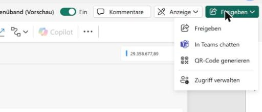
*Freigeben-Menü: Link, Teams, QR-Code*

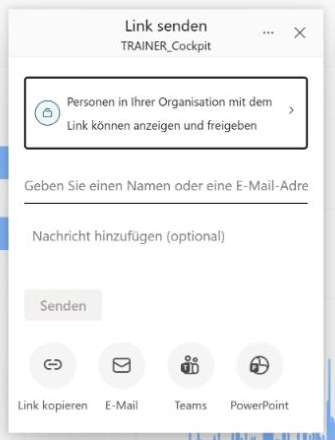
*Dialog Link senden*

**Erledigt, wenn:** Sie den Link in den Kurs-Chat gestellt haben und der Bericht auf dem Handy aufgeht.

Hinweis

Bei Telekom bekommen Endnutzer Berichte über Apps. Links sind für die schnelle Abstimmung unter Kollegen gedacht. Die Option „vorhandener Zugriff“ gibt niemandem neue Rechte.

## Station 2: Kommentar mit @-Erwähnung
- [ ] Klicken Sie im Cockpit auf **Kommentare**.
- [ ] Kommentieren Sie ein einzelnes Visual (Visual-Menü **…** > **Kommentar hinzufügen**).
- [ ] Erwähnen Sie Ihre Sitznachbarin oder Ihren Sitznachbarn mit `@Name`.

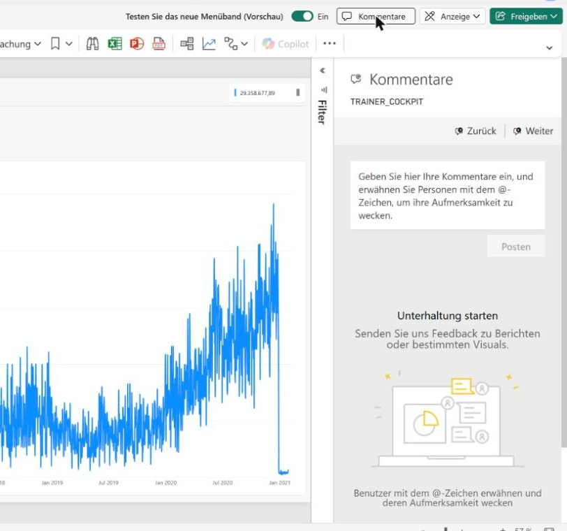
*Kommentarbereich am Bericht*

**Erledigt, wenn:** die erwähnte Person die Benachrichtigung bekommt und über den Link direkt beim Visual landet.

## Station 3: Persönliches Lesezeichen als Standardansicht
- [ ] Setzen Sie im Cockpit einen Filter (z. B. Region Europa, Jahr 2020).
- [ ] **Lesezeichen** > **Persönliches Lesezeichen hinzufügen**, Name `Meine Sicht`, Option **Als Standardansicht festlegen**.
- [ ] Schließen Sie den Bericht und öffnen Sie ihn erneut.

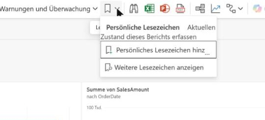
*Lesezeichen > Persönliches Lesezeichen*

**Erledigt, wenn:** der Bericht mit Ihrem Filter öffnet, für andere aber unverändert bleibt.

## Station 4: „Diese Daten erkunden“
- [ ] Visual-Menü **…** > **Diese Daten erkunden**.
- [ ] Tauschen Sie ein Feld (z. B. Kategorie statt Region) und wechseln Sie zur Matrix.
- [ ] Speichern Sie das Ergebnis als `AW_<Projekt>_<Kürzel>_Erkundung`.

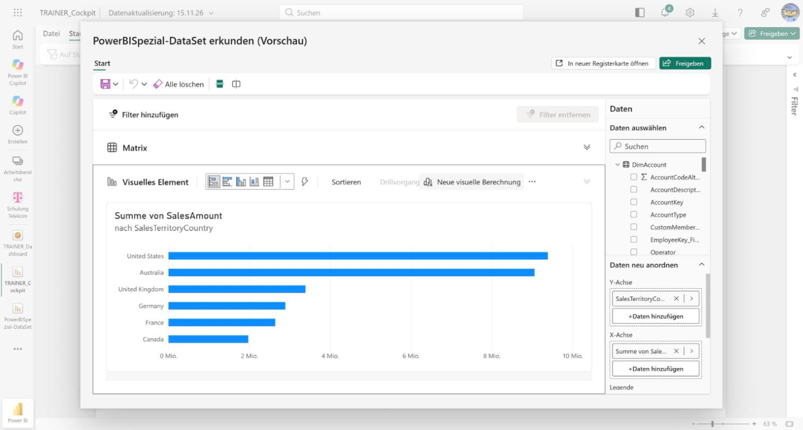
*Fenster „Diese Daten erkunden“*

**Erledigt, wenn:** die Erkundung im Arbeitsbereich liegt und das Cockpit unverändert ist.

Hinweis

Erkunden ist eine Vorschaufunktion. Wenn der Eintrag fehlt, ist sie im Tenant noch nicht freigegeben. Weiter mit Station 5.

## Station 5: Als Tabelle anzeigen und Einblicke
- [ ] Visual-Menü **…** > **Als Tabelle anzeigen**: Prüfen Sie die Zahlen hinter dem Diagramm.
- [ ] Rechtsklick auf einen Datenpunkt > **Analysieren** > **Erklären der Erhöhung** bzw. Visual-Menü > **Einblicke abrufen**.

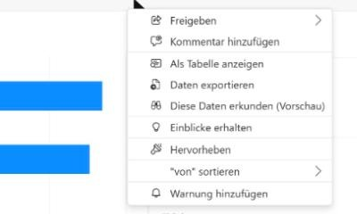
*Visual-Menü: Als Tabelle anzeigen, Einblicke*

**Erledigt, wenn:** Sie eine Erklärung für einen Anstieg gefunden haben.

## Station 6: Seite live nach PowerPoint
- [ ] **Exportieren** > **PowerPoint** > **Livedaten einbetten** > Link kopieren (oder **Öffnen in PowerPoint**).
- [ ] Fügen Sie die Seite in eine leere Präsentation ein und filtern Sie in PowerPoint.

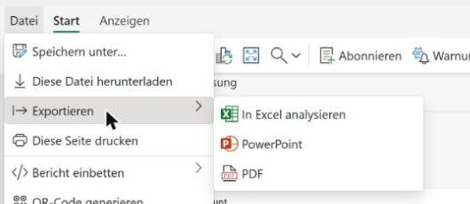
*Exportieren > PowerPoint*

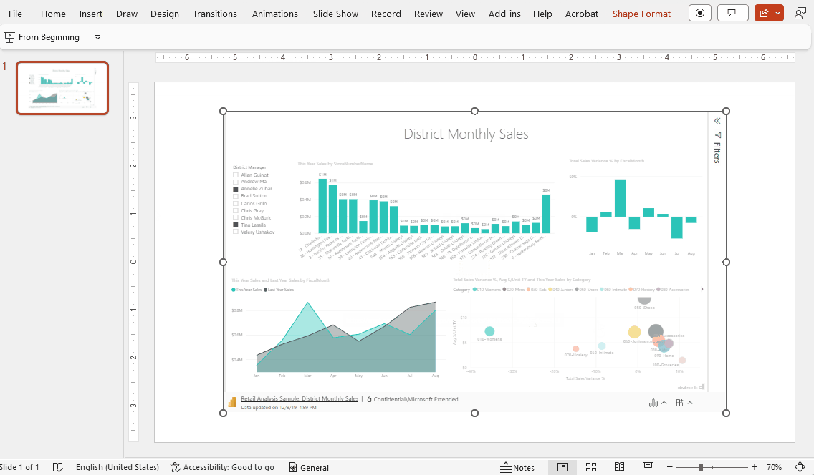
*Live-Seite in PowerPoint (Bild: Microsoft Learn)*

**Erledigt, wenn:** die Seite in PowerPoint interaktiv ist.

## Station 7: Bericht in Teams
- [ ] **Freigeben** > **In Teams chatten** und an sich selbst oder Ihre Nachbarin senden.
- [ ] Optional: Fügen Sie den Bericht in einem Test-Kanal als Registerkarte **Power BI** hinzu (nur wenn Sie einen eigenen Kanal haben).

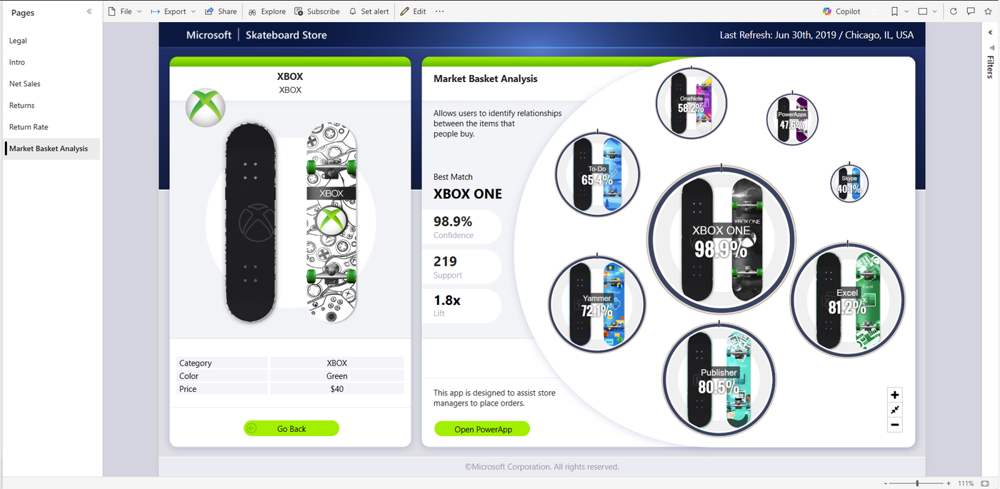
*Power BI als Registerkarte in Teams (Bild: Microsoft Learn)*

**Erledigt, wenn:** der Bericht in Teams als Vorschau-Karte erscheint.

## Station 8: Bericht auf dem Handy
- [ ] Installieren Sie die App **Microsoft Power BI** (iOS/Android) und melden Sie sich mit dem Firmenkonto an.
- [ ] Öffnen Sie **Arbeitsbereiche** > Schulungsarbeitsbereich > Ihr Cockpit. Markieren Sie es als Favorit.

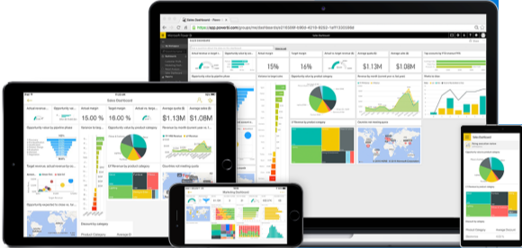
*Power BI Mobile (Bild: Microsoft Learn)*

**Erledigt, wenn:** Ihr Cockpit auf dem Handy läuft.

Hinweis

Ohne Firmenhandy oder ohne App-Freigabe: Diese Station auslassen. Für ein eigenes Handy-Layout: Desktop > Ansicht > Mobiles Layout.

## Station 9: Webmodellierung, Best Practice Analyzer und Speicheranalyse
- [ ] Öffnen Sie **Ihr Modell** `AW_<Projekt>_<Kürzel>` im Arbeitsbereich: Menü **…** > **Semantisches Modell öffnen**.
- [ ] Menüband: **Best Practice Analyzer** ausführen. Notieren Sie die drei häufigsten Hinweise.
- [ ] **Speicheranalyse** öffnen: Welche Spalte braucht den meisten Speicher?

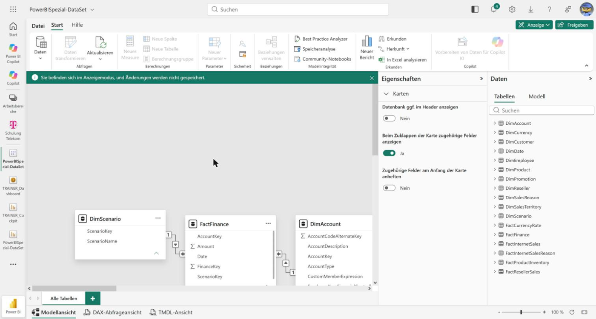
*Webmodellierung mit Best Practice Analyzer und Speicheranalyse im Menüband*

**Erledigt, wenn:** Sie eine konkrete Aufräumaktion für Ihr Modell benennen können (z. B. Spalte entfernen, Datentyp ändern).

## Station 10: Datenherkunft und Auswirkungsanalyse
- [ ] Im Arbeitsbereich oben rechts auf die Ansicht **Datenherkunft** umschalten.
- [ ] Suchen Sie **Ihr** Modell `AW_<Projekt>_<Kürzel>`: Welche Berichte und Dashboards hängen daran?
- [ ] Beim Modell auf das Symbol **Auswirkungsanalyse anzeigen**: Wie viele Elemente, Arbeitsbereiche und Betrachter wären von einer Änderung betroffen?

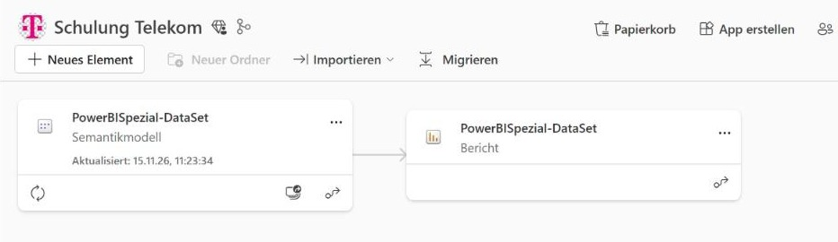
*Ansicht Datenherkunft im Arbeitsbereich*

**Erledigt, wenn:** Sie sagen können, wen Sie informieren müssten, bevor Sie eine Spalte in Ihrem Modell umbenennen.

## Station 11: Visuelle Berechnung
- [ ] Bearbeiten Sie Ihr Cockpit, markieren Sie ein Säulendiagramm mit Umsatz nach Monat.
- [ ] Menüband **Neue visuelle Berechnung** > Vorlage **Laufende Summe**.
- [ ] Optional: Vorlage **Im Vergleich zum vorherigen**.

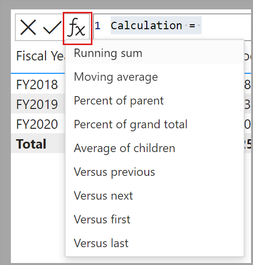
*Vorlagen für visuelle Berechnungen (Bild: Microsoft Learn)*

**Erledigt, wenn:** das Visual eine laufende Summe zeigt, ohne dass ein Measure im Modell angelegt wurde.

## Station 12: Höherstufen und Vertraulichkeitsbezeichnung
- [ ] Einstellungen **Ihres Modells** > **Bestätigung und Ermittlung** > **Höhergestuft**.
- [ ] Im Cockpit: **Datei** > **Vertraulichkeit** bzw. Kopfzeile > Bezeichnung **Intern** setzen (falls angeboten).

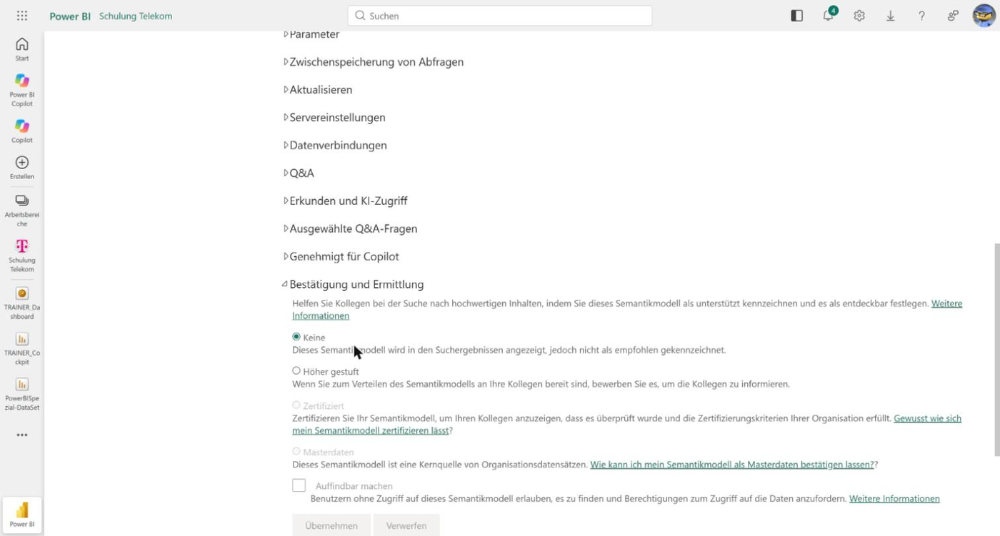
*Einstellungen > Bestätigung und Ermittlung*

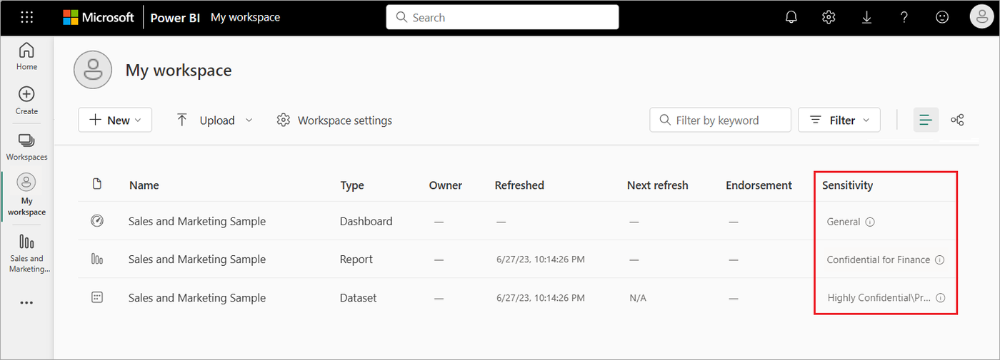
*Vertraulichkeitsbezeichnung (Bild: Microsoft Learn)*

**Erledigt, wenn:** Ihr Modell das Höhergestuft-Symbol trägt.

## Station 13: Nutzungsmetriken
- [ ] Cockpit-Menü **…** > **Nutzungsmetriken anzeigen**.
- [ ] Wer hat Ihr Cockpit heute geöffnet? Wie lange lädt die Seite?

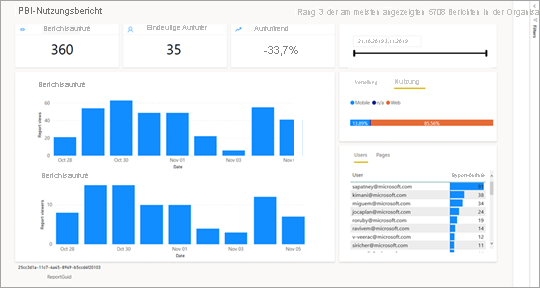
*Bericht Nutzungsmetriken (Bild: Microsoft Learn)*

**Erledigt, wenn:** Sie die Aufrufe von heute sehen (Daten können bis zu einem Tag verzögert sein).

## Station 14: Zeitzone der Aktualisierung prüfen
- [ ] Einstellungen **Ihres Modells** > **Aktualisieren**.
- [ ] Prüfen Sie die **Zeitzone** (Standard UTC) und stellen Sie sie auf **(UTC+01:00) Amsterdam, Berlin …**.
- [ ] Legen Sie einen Zeitplan für 06:00 an und tragen Sie unter **Fehlerbenachrichtigungen** sich selbst ein.

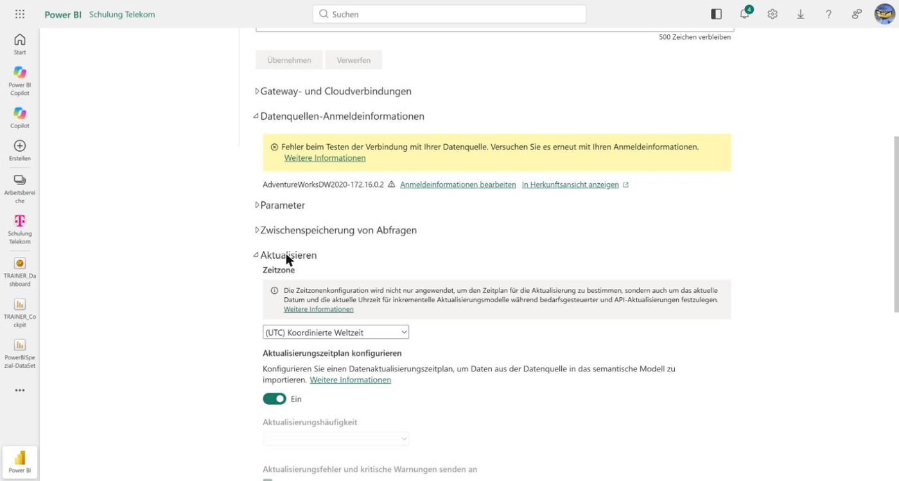
*Einstellungen > Aktualisieren: Zeitzone und Zeitplan*

**Erledigt, wenn:** Zeitplan und Zeitzone gespeichert sind.

Warum ist das wichtig?

Die Zeitzone bestimmt nicht nur, wann aktualisiert wird, sondern auch, welcher Tag für die inkrementelle Aktualisierung als „heute“ gilt.

---

## Abschlussrunde (3 Minuten)
Jede Person nennt **eine** Station, die sie ab Montag nutzen wird, und **eine**, die für die eigenen Berichtsnutzer wichtig ist.
