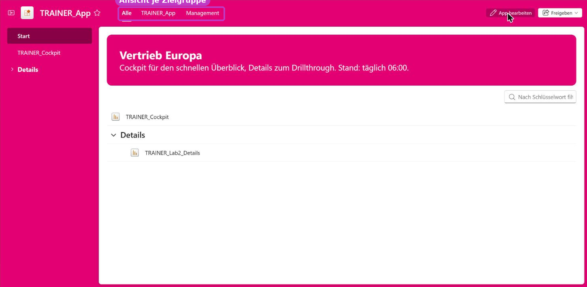
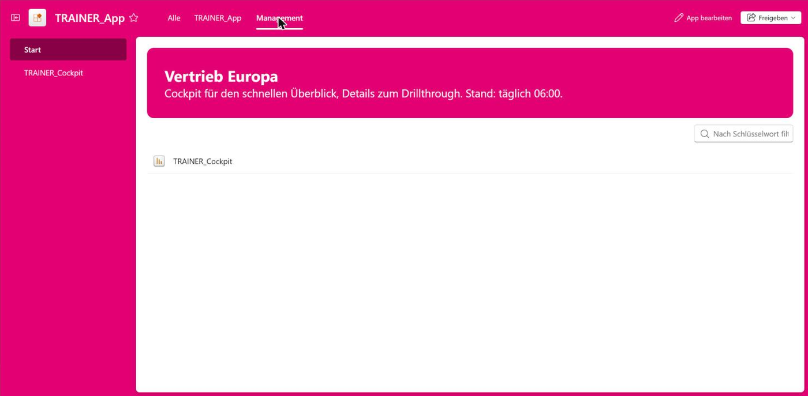
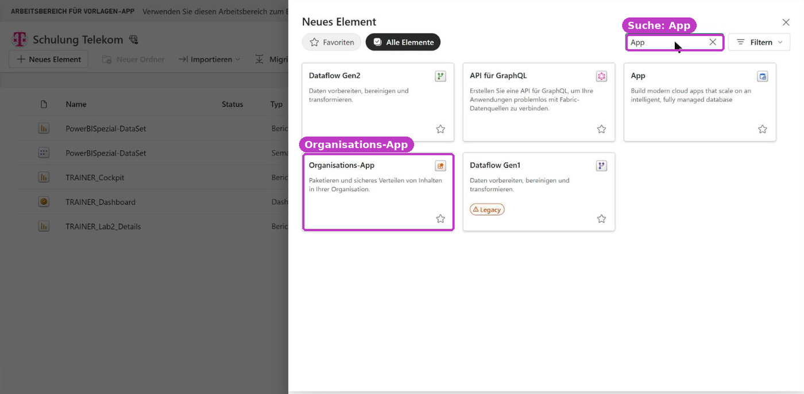
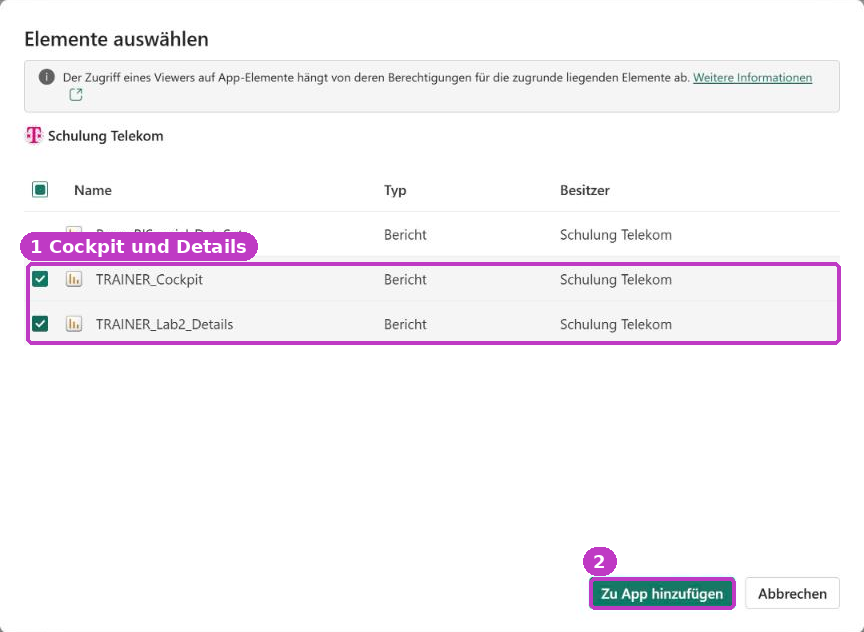
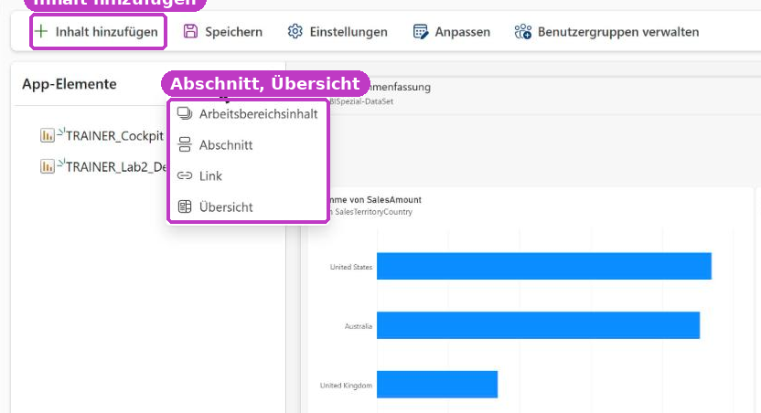
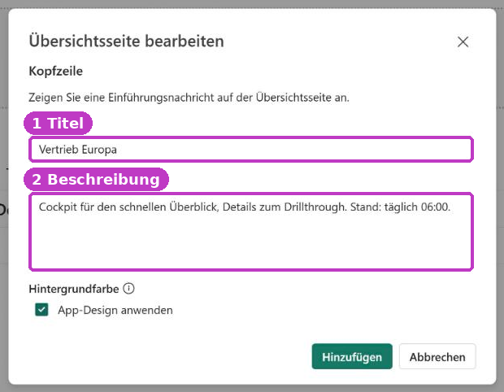
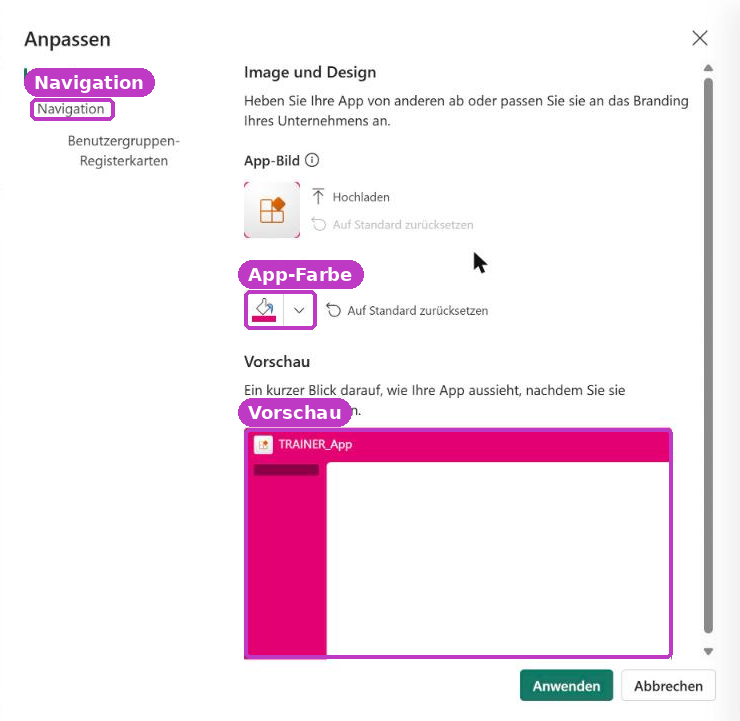
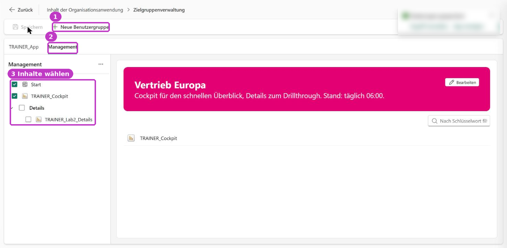
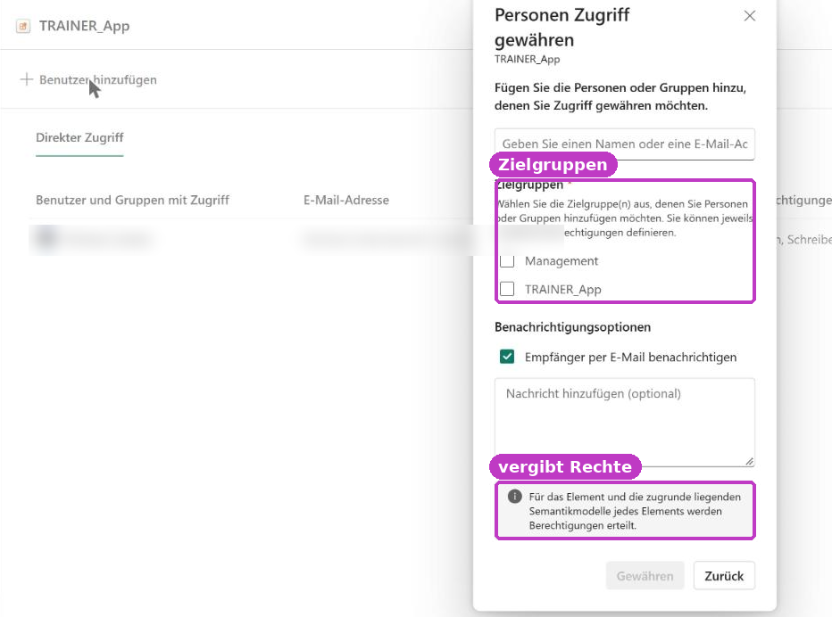

# Lab 3 Teil B: Ihre Organisations-App

| | |
|---|---|
| **Dauer** | 15 Minuten |
| **Ausgangspunkt** | Ihr Cockpit und Ihr Detailbericht aus Lab 1 und 2 |
| **Ergebnis** | Organisations-App `AW_<Projekt>_<Kürzel>_App` mit Startseite, Abschnitt, Farbe und einer Zielgruppe für das Management |

> **Wichtig:** Eine Organisations-App (kurz Org-App) ist ein eigenes Element im Arbeitsbereich. Davon darf es mehrere geben, deshalb baut jede Person ihre eigene App. Vergeben Sie **keinen Zugriff** an andere Personen: Wer Zugriff auf eine App bekommt, erhält Leserechte auf die Berichte und die Semantikmodelle dahinter. Sie selbst sehen Ihre App als Mitwirkende im Arbeitsbereich ohnehin.

## Ihr Auftrag

Ihr Auftraggeber möchte nicht im Arbeitsbereich suchen, sondern **eine App** öffnen, in der alles Wichtige an einem Ort liegt:

1. Eine Org-App mit Ihrem Cockpit und Ihrem Detailbericht.
2. Eine **Startseite**, die sagt, wofür die App da ist und wie aktuell die Daten sind.
3. Der Detailbericht liegt in einem **Abschnitt** „Details“.
4. Die App trägt eine **Farbe** passend zum Firmenauftritt.
5. Das **Management** sieht nur Startseite und Cockpit, keine Details.

## Zielbild

So ungefähr soll Ihr Ergebnis aussehen. Oben wechseln Sie zwischen den Zielgruppen.

*Zielbild: Org-App mit Startseite, Abschnitt Details und Zielgruppen*

*Sicht der Zielgruppe Management: nur Start und Cockpit*

## Wo finde ich was?

*Arbeitsbereich > Neues Element > Suche „App“ > Organisations-App*

*Inhalt hinzufügen: Berichte auswählen > Zu App hinzufügen*

*App-Elemente > Hinzufügen: Abschnitt, Link, Übersicht*

*Übersichtsseite > Header hinzufügen: Titel und Beschreibung*

*Anpassen: App-Farbe, App-Bild, Navigation*

*Benutzergruppen verwalten > Neue Benutzergruppe > Inhalte anhaken*

*Freigeben > Zugriff verwalten > Benutzer hinzufügen: nur ansehen, nichts gewähren*

## Abnahme

- [ ] Org-App `AW_<Projekt>_<Kürzel>_App` liegt im Arbeitsbereich.
- [ ] Sie enthält Ihr Cockpit und Ihren Detailbericht, der Detailbericht steht im Abschnitt **Details**.
- [ ] Eine Übersichtsseite **Start** steht oben, mit Titel und einem Satz zum Datenstand.
- [ ] Unter **Anpassen** ist eine App-Farbe gesetzt.
- [ ] Eine Zielgruppe **Management** zeigt nur Start und Cockpit.
- [ ] Unter **Zugriff verwalten** haben Sie niemanden hinzugefügt.

## Test: Funktioniert es?

| Was Sie tun | Erwartetes Ergebnis |
|---|---|
| Arbeitsbereich-Liste nach Ihrem Kürzel filtern | Ein neues Element `AW_<Projekt>_<Kürzel>_App` mit dem Typ **Organisations-App** |
| In der App oben rechts **App anzeigen** | Die App öffnet sich in Ihrer Farbe, links die Navigation **Start**, Cockpit, **Details** |
| Oben auf **Alle** klicken | Alle Elemente sind sichtbar, auch der Abschnitt Details |
| Oben auf **Management** klicken | Links stehen nur **Start** und Ihr **Cockpit**. Der Abschnitt Details ist verschwunden. |
| In der App das Cockpit öffnen, Projekt A mit Filter Europe und Jahr 2020 | Dieselben Zahlen wie im Bericht selbst: `Umsatz` **5.464.395**. Die App zeigt keine Kopie, sondern den Originalbericht. |
| Im Arbeitsbereich im Cockpit etwas ändern und speichern, dann die App neu laden | Die Änderung ist in der App sofort sichtbar. Org-Apps zeigen immer den aktuellen Stand der Berichte. |
| **Freigeben** > **Zugriff verwalten** | In der Liste steht keine Person, die Sie hinzugefügt haben |

**Fehlerbilder:** Die Zielgruppe Management zeigt noch die Details: Die Haken wurden gesetzt, aber nicht **gespeichert**. Die Farbe fehlt in der App: Unter **Anpassen** auf **Anwenden** und danach auf **Speichern** klicken. Ihr Dashboard steht nicht zur Auswahl: Dashboards lassen sich in Org-Apps nicht aufnehmen, nur Berichte.

Hinweise

- Die erste Zielgruppe heißt so wie Ihre App und enthält alles. **Management** legen Sie zusätzlich an.
- Zielgruppen steuern, was jemand **sieht**, nicht welche **Daten** er sieht. Für die Daten bleibt RLS zuständig.
- Die Reihenfolge links ändern Sie per Ziehen. Ein Bericht wandert in den Abschnitt, wenn Sie ihn auf den Abschnitt ziehen.
- Org-Apps lassen sich ohne eigenes Veröffentlichen bearbeiten: Was Sie speichern, ist sofort in der App.

Lösungsweg (Beispiel Projekt A)

1. Arbeitsbereich > **Neues Element** > im Suchfeld `App` > **Organisations-App** > Name `AW_A_ML_App` > **Erstellen**.
2. **Inhalt hinzufügen** > Haken bei `AW_A_ML` (Ihr Cockpit aus Lab 1) und `AW_A_ML_Details` > **Zu App hinzufügen**.
3. **Hinzufügen** > **Abschnitt** > `Details` > **Erstellen**. `AW_A_ML_Details` auf den Abschnitt ziehen.
4. **Hinzufügen** > **Übersicht** > `Start` > **Erstellen**. Nach ganz oben ziehen.
5. Start öffnen > **Header hinzufügen** > Titel `Vertrieb Europa`, Beschreibung `Cockpit für den Überblick, Details zum Drillthrough. Stand: täglich 06:00.` > **App-Design anwenden** > **Hinzufügen**.
6. **Anpassen** > **Branding** > App-Design: Farbe wählen > **Anwenden** > **Speichern**.
7. **Benutzergruppen verwalten** > **Neue Benutzergruppe** > `Management` > Haken bei **Details** entfernen > **Speichern**.
8. **App anzeigen** > oben zwischen **Alle** und **Management** wechseln.

## Wenn Sie früher fertig sind

- Fügen Sie über **Hinzufügen** > **Link** einen Link auf die GitHub-Anleitung ein. Wo erscheint er in der Navigation?
- Schauen Sie sich unter **Anpassen** > **Navigation** die getrennte App- und Seitennavigation an. Was ist für Ihr Management übersichtlicher?
