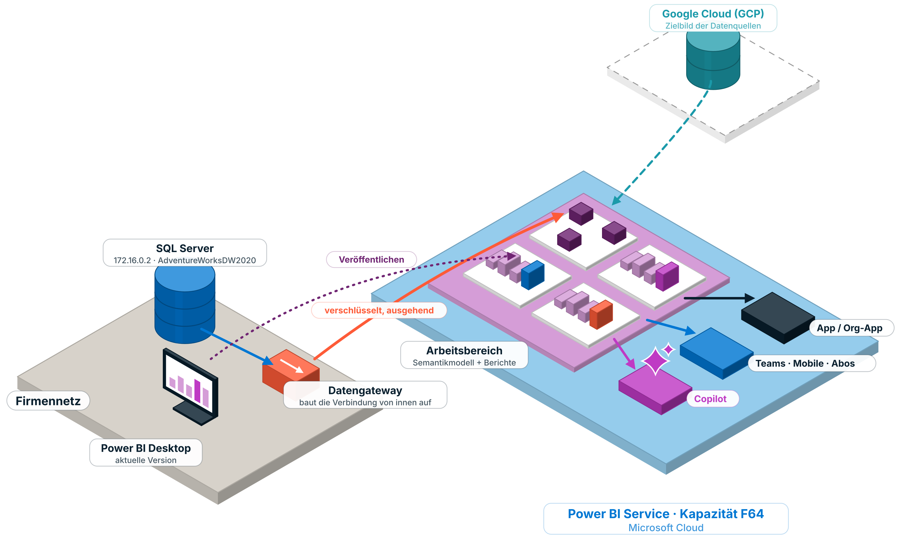

# Power BI Spezial: Cloud Transition

*Vom Report Server in den Power BI Service*

Übungen für erfahrene Power-BI-Entwickler, die vom **Power BI Report Server** in den **Power BI Service** wechseln.

> **Schwerpunkt Cloud:** Was Sie aus Desktop kennen (Visuals, Power Query, DAX), nutzen Sie nur kurz. Geübt wird, was im Service neu ist. Wir arbeiten mit **Import-Modellen, ohne DirectQuery**.
Die Grundlagen aus PL-300 setzen wir voraus. Hier geht es um das, was in der Cloud neu oder anders ist.

## So laufen die Labs

Jedes Lab hat denselben Ablauf:

| Schritt | Was | Dauer |
|---|---|---|
| 1 | **Auftrag:** Sie setzen das Ziel in **Ihrem eigenen Projekt** um | 30 Min. |
| 2 | **Abnahme:** Die Kriterien zeigen, wann Sie fertig sind | |
| 3 | **Hinweise** und **Lösungsweg** zum Aufklappen, falls Sie hängen | |

Es gibt keine Klick-für-Klick-Anleitung. Sie kennen Power BI. Versuchen Sie es zuerst selbst, die Hinweise sind für den Notfall da.

**Remote arbeiten:** Legen Sie diese Anleitung und Power BI nebeneinander, am besten auf zwei Bildschirme. Bleiben Sie während der Labs in der Teams-Besprechung. Fragen gehören in den Chat. Wenn Sie hängen, teilen Sie auf Zuruf Ihren Bildschirm.

## Ihr Projekt

Sie bauen über den Tag **ein eigenes Projekt** auf: Berichte, ein Dashboard und am Ende ein eigenes Modell.
Wählen Sie einen Steckbrief. Je Steckbrief arbeiten höchstens zwei Personen.

| Nr. | Projekt | Auftraggeber | Zentrale Frage | Wichtige Tabellen |
|---|---|---|---|---|
| A | **Vertrieb Europa** | Vertriebsleitung Europa | Wie entwickeln sich Umsatz und Marge in den europäischen Ländern? | FactInternetSales, DimSalesTerritory, DimGeography |
| B | **Produktmanagement Bikes** | Produktmanagement | Welche Bike-Modelle und Farben laufen, welche nicht? | FactInternetSales, DimProduct, Subkategorie, Kategorie |
| C | **Händlergeschäft** | Leitung Partnervertrieb | Welche Händler und Vertriebsmitarbeiter tragen den Umsatz? | FactResellerSales, DimReseller, DimEmployee |
| D | **Kundenanalyse** | Marketing | Welche Kundengruppen kaufen wie viel, und wie oft? | FactInternetSales, DimCustomer, DimGeography |
| E | **Promotionen** | Marketing / Pricing | Lohnen sich Rabattaktionen? | FactInternetSales, FactResellerSales, DimPromotion |

## Datenquelle: eine Datei für alle

Laden Sie **[`daten/AW_Uebungsdaten.pbix`](daten/AW_Uebungsdaten.pbix)** herunter (in GitHub: Datei öffnen > **Download raw file**). Die Datei enthält:

- alle Tabellen der **AdventureWorksDW2020** als **Import**, Daten von 2018 bis Januar 2021,
- Beziehungen inklusive Datum, Produktkategorie und Kundengeografie,
- 17 fertige Kennzahlen im Ordner **Kennzahlen** (`Umsatz`, `Umsatz VJ`, `Marge %`, `Händlerumsatz` …),
- drei Rollen für die Zeilensicherheit: `Vertrieb Europa`, `Vertrieb Nordamerika`, `Vertrieb Pazifik`.

Sie brauchen **keinen Zugriff auf die Datenbank**. Klicken Sie in Desktop nicht auf **Aktualisieren**, die Daten sind schon drin.

## Spielregeln: 10 Personen, ein Arbeitsbereich

Power BI benennt Semantikmodell und Bericht nach dem **Dateinamen**. Damit niemand die Arbeit eines anderen überschreibt:

1. **Sofort nach dem Öffnen umbenennen:** **Datei** > **Speichern unter** > `AW_<Projekt>_<Kürzel>.pbix`, z. B. `AW_A_ML.pbix`.
2. **Alle weiteren Elemente** (Berichte im Browser, Dashboards, Erkundungen) heißen `AW_<Projekt>_<Kürzel>_<Was>`, z. B. `AW_A_ML_Details`.
3. Fragt Power BI beim Veröffentlichen **„Dieses Dataset ersetzen?“**, lesen Sie den Namen. Ist es nicht Ihrer: **Abbrechen**.
4. Arbeiten Sie im Service nur mit **Ihren** Elementen. Im Zweifel nach Ihrem Kürzel filtern (Suchfeld im Arbeitsbereich).
5. Berechtigungen im Arbeitsbereich vergeben die Admins nach den Guidelines. In den Labs ändern wir keine Rollen.

| Element | Name (Beispiel Projekt A, Kürzel ML) | Entsteht in |
|---|---|---|
| Semantikmodell + Bericht | `AW_A_ML` | Lab 1 |
| Detailbericht (Browser) | `AW_A_ML_Details` | Lab 2 |
| Erkundung | `AW_A_ML_Erkundung` | Lab 2 |
| Dashboard | `AW_A_ML_Dashboard` | Lab 3 |

## Dateien in diesem Repository

| Datei | Inhalt |
|---|---|
| [`daten/AW_Uebungsdaten.pbix`](daten/AW_Uebungsdaten.pbix) | **Ihre Datenquelle** für alle Labs (siehe oben) |
| [`folien/PowerBI_Spezial_Cloud_Folien.pdf`](folien/PowerBI_Spezial_Cloud_Folien.pdf) | Die Folien des Tages zum Nachlesen |
| [`daten/AW_Zentral_Kennzahlen.tmdl`](daten/AW_Zentral_Kennzahlen.tmdl) | Die Kennzahlen und Rollen als TMDL-Skript, zum Nachlesen. In `AW_Uebungsdaten.pbix` bereits enthalten. |

Die Bilder in den Anleitungen (Ordner `images/labs`) zeigen echte Ergebnisse aus der Schulungsumgebung. Bilder mit dem Hinweis „Microsoft Learn“ stammen aus der Microsoft-Dokumentation (learn.microsoft.com), © Microsoft, veröffentlicht unter [CC BY 4.0](https://creativecommons.org/licenses/by/4.0/).

## Labs

| Lab | Ziel | Dauer |
|---|---|---|
| [Lab 1](Lab-01-Projektstart/README.md) | Projektstart: Übungsdatei laden, Cockpit bauen, veröffentlichen, im Service prüfen | 30 Min. |
| [Lab 2](Lab-02-Erweitern/README.md) | Im Service weiterbauen: Bericht im Browser, visuelle Berechnung, berichtsübergreifender Drillthrough, Erkunden | 30 Min. |
| [Lab 3](Lab-03-Verteilen/README.md) | Dashboard, Warnung, Abo, Excel und RLS-Test | 30 Min. |
| [Lab 3 Teil B](Lab-07-App/README.md) | Ihre Organisations-App: Startseite, Abschnitte, Branding, Zielgruppe Management | 15 Min. |
| [Lab 4](Lab-04-Eigenes-Modell/README.md) | Große Modelle: inkrementelle Aktualisierung, Zeitplan, Höherstufen, RLS-Test, Speicheranalyse, Vorlage | 30 Min. |
| [Lab 5](Lab-05-Cloud-Stationen/README.md) | Cloud-Stationen: 14 Neuerungen selbst ausprobieren (mind. 8) | 30 Min. |
| [Lab 4 Teil C](Lab-06-WhatIf/README.md) | What-If-Simulation und Prognose (in Lab 4, ohne Datenbankzugriff oder als Erweiterung) | in Lab 4 |

Außerdem:
- [Migrations-Checkliste](Migrations-Checkliste.md)
- [Folien als PDF](folien/PowerBI_Spezial_Cloud_Folien.pdf)

Menüpfade sind für die deutsche Oberfläche angegeben, in Klammern der englische Begriff.
